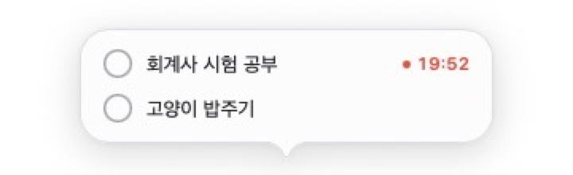

# Typing Pet for macOS

[한국어](README.md) | [English](README.en.md)

A native macOS menu bar app that reacts to your keystrokes with pet images you choose.


This unofficial macOS app was inspired by [swoonqx/TypingPet](https://github.com/swoonqx/TypingPet) for Windows. It is a new implementation and does not include the original project's source code or image assets.

## Install

**Requirements:** Apple Silicon Mac with macOS 13 or later. The current public build is the `v0.16.0` prerelease. It is signed with an Apple-issued Developer ID certificate and notarized by Apple, so you do not need to bypass Gatekeeper.

### Install with Homebrew

```sh
brew tap ynifamily3/tap
brew install --cask ynifamily3/tap/typing-pet
```

Open `TypingPet.app` from Applications after installation. Use `--adopt` only if an existing app is identical to the release being installed; otherwise keep the old app separately before installing.

The app supports automatic updates. To update through Homebrew, quit the app, run `brew update`, then `brew upgrade --cask --greedy ynifamily3/tap/typing-pet`.

### Install the ZIP manually

1. Open the [v0.16.0 release](https://github.com/ynifamily3/TypingPetMac/releases/tag/v0.16.0) and download `TypingPetMac-v0.16.0-arm64.zip`. For an optional integrity check, download the `.sha256` file from the same page.
2. Double-click the ZIP to extract it. Move `TypingPet.app` to **Applications** before launching; do not run it from Downloads.
3. Open `TypingPet.app` from Applications. A paw icon appears in the menu bar.

If you downloaded both files into Downloads, verify the ZIP with:

```sh
cd ~/Downloads
shasum -a 256 -c TypingPetMac-v0.16.0-arm64.zip.sha256
```

### First launch: Input Monitoring

The app needs macOS **Input Monitoring** permission to react while you use other apps. The welcome window lets you try pet reactions before requesting permission.

1. Click the preview area and press keys. This local preview needs no permission.
2. Select `다른 앱에서도 반응하도록 설정` (Set up reactions in other apps), then enable TypingPet in System Settings > Privacy & Security > Input Monitoring.
3. If it is missing, expand `목록에 없나요?` (Not in the list?) and drag the app icon into the list. Alternatively, use `+` to select the app in Applications.
4. Return to another app and type. The guide closes after receiving the first real global key event. If macOS asks you to quit and reopen, follow its prompt; verification resumes on relaunch.

Choose `나중에` (Later) to continue using the app and resume setup from the menu bar or Settings.

> [!IMPORTANT]
> When moving from an older ad-hoc-signed build, you may need to grant Input Monitoring permission once more. If the pet does not react, remove the old `TypingPet` entry with `-`, add the app again, and enable its switch. Future updates signed by the same Developer ID team can retain the permission.

**If you have v0.14.1 or earlier, install the latest release manually once.** The old update signing key was lost and replaced, so those builds cannot accept the new feed. Starting with v0.14.2, the app checks daily and installs an update after you approve it, on restart or quit. The [update documentation](docs/UPDATE.md) explains verification.

## In action

An example compact list with `고양이 밥주기` (Feed the cat) and `회계사 시험 공부` (Study for the CPA exam):


Start the study timer while keeping both tasks in the compact list:



The focus bubble shows the remaining time; hover over it for pause, resume, and stop controls:


These screenshots use sample tasks in the isolated development app. The distributed app has the same layout.

## Features

- Show `pet-idle.png` while idle and switch to a different reaction image on each global key event.
- Assign images to specific keys or modifier combinations; exact matches take priority over random reactions.
- Drag the pet when position lock is off. A quick release glides a little before settling.
- Hover to enlarge the pet, or grab it for a pressed-down spring effect. Set resting and hover opacity independently.
- Optionally let a click-through, position-locked pet move away from the pointer while staying on-screen.
- Hover controls hide or proportionally resize the pet. A gear immediately left of the resize handle opens Settings. Restore a hidden pet from the menu bar.
- Return to the idle image after 0.75 seconds without input.
- Never store ordinary typed characters. Custom key rules store only the selected physical key code and modifier combination locally.

## Todos and focus timer

Move the pointer near the pet and select `할 일` (Todo). Enter a title and press Return. Each task has its own countdown or count-up setting; use the arrow to change it and the main button to start. The focus view supports pause, resume, stop, and countdown extension.

Tasks and measured focus time are stored on this Mac in `~/Library/Application Support/TypingPet/todo-state.json`. Open the file from Settings > `할 일` > `기록 데이터 열기` (Reveal Record Data). Sleep and app restarts do not add offline time to a focus session. See the [Todo guide](docs/TODO.md) for details.

## Settings and images

Open `설정` (Settings) from the paw icon in the menu bar.

- `일반` (General): pet size, opacity, bounce, always-on-top, position lock and pointer avoidance, language (System/Korean/English), Settings and bubble appearance (System/Light/Dark), launch at login, Input Monitoring, and updates.
- `갤러리` (Gallery): add, preview, select, rename, and remove image sets.
- `키 반응` (Key Reactions): assign or remove images for keys and key combinations.

The Gallery can change the idle image, replace reaction images, import a folder as a set, or restore the built-in images. Imported sets are copied to `~/Library/Application Support/TypingPet/Images/Sets`; key-specific images go to `~/Library/Application Support/TypingPet/KeyReactions`, so their originals may be moved afterward.

For a folder set, name the idle image `idle.*` or `pet-idle.*`; other supported images become reactions. If there is no idle-named image, the first image in sorted order is used. A one-image folder works for both idle and reaction states. PNG, APNG, JPG, JPEG, GIF, TIFF, HEIC, HEIF, and WebP are supported. Images of different proportions are fitted inside a canvas based on the idle image.

## Develop and build

After development and manual checks, the [release pipeline](docs/RELEASE.md) runs tests, builds, signs, notarizes, and deploys a new version. Update and commit `version.json` and the changelog, push the release commit, then run `./scripts/release.sh --homebrew`. Use `--dry-run` for a read-only preflight.

Local development uses **TypingPet Dev**, with separate app identity, settings, images, and Todo records. The installed production app can remain open.

```sh
./scripts/run_dev.sh
```

This builds and opens the debug app. Quit Dev and rerun the script after code changes. See [development setup and data separation](docs/DEVELOPMENT.md).

Build requirements are an Apple Silicon Mac, macOS 13 or later, and Swift 6 with Xcode Command Line Tools:

```sh
swift test
./scripts/build_app.sh
open "dist/TypingPet Dev.app"
```

The build script selects a Developer ID Application, Apple Development, or ad-hoc signing identity from Keychain, in that order. Set `CODE_SIGN_IDENTITY` to choose one explicitly. Public distribution also requires an Apple Developer Program membership, a Developer ID Application certificate, and notarization credentials; see the [Developer ID guide](docs/DEVELOPER_ID.md).

## Privacy

- Ordinary typed characters are not stored or sent over the network.
- Custom key reactions store only the physical key code and modifiers you select, locally.
- Network requests are limited to update checks and downloads. Requests to `pet.miel.ing` do not include user information, device identifiers, or input history; automatic checks can be disabled in Settings.
- The local Todo JSON contains titles, completion dates, timer preferences, and measured focus time. There is no Todo account, sync, or server upload.

## License

- Source code: [MIT](LICENSE)
- Built-in keyboard-cat assets: [CC0 1.0](ASSET_LICENSE.md)

The built-in cat is an AI-generated placeholder created for this repository. Images imported by users remain subject to their original creators' rights.
