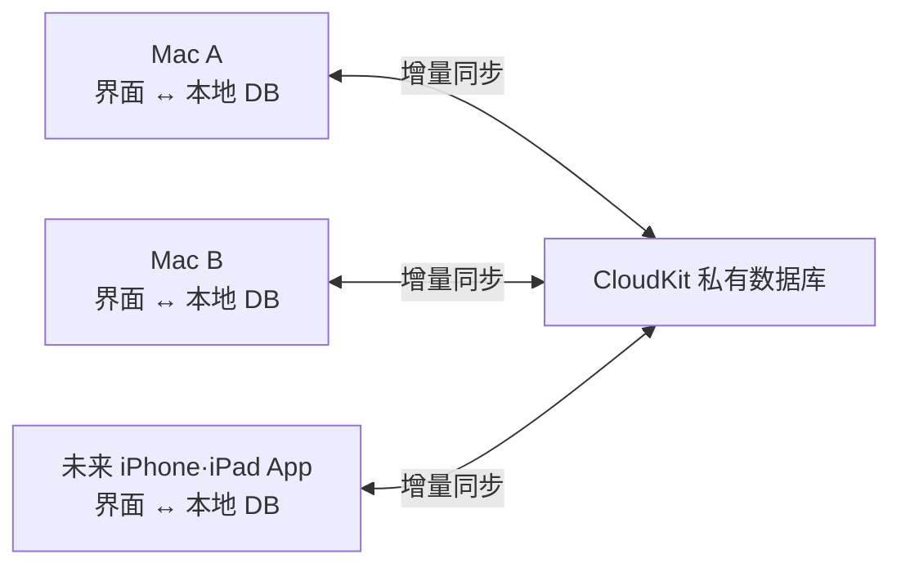

# 待办事项多端同步设计方案评审 (Todo Sync Design Review)

撰写 / 修订日期：2026-10-24

当前状态：**设计方案评审 / 暂未实现**

当前版本的 TypingPet 将待办与专注数据完全保存在当前 Mac 本地的 `todo-state.json` 中，不提供账户体系或云同步功能。本篇笔记旨在梳理未来向多设备扩展时的架构设计、数据存储及隐私保护要点。本文档仅为探索讨论，不构成正式功能承诺。

## 1. 评审范围

- 优先支持**多台 Mac 之间**的待办事项同步。
- 随后考虑向 **iPhone / iPad** 生态延展。
- 首期重点同步**待办事项基础数据**，动作包画廊与自定义图片素材暂不纳入同步范围。
- 坚持**本地优先 (Local-First)** 架构：断网可用，读写零延迟。

是否需要独立注册系统、是否采用 CloudKit、是否连通系统自带“提醒事项”以及专注记录的同步颗粒度，目前均在探讨中。

## 2. 核心架构考量与方案对比

| 核心焦点 | 推荐首选方案 | 待定考量 |
|---|---|---|
| 数据真源存放在哪？ | TypingPet 专属数据模型 + 本地数据库 | 是否有必要以系统“提醒事项”为核心原点 |
| 云端同步存储选型？ | 鉴于主要在 Apple 生态，优先评估 CloudKit 私有数据库 | 需在正式分发应用中验证 CloudKit POC |
| 是否需要独立账号？ | 初始版本无需注册独立账号，零门槛体验 | 未来多系统（如 Windows/Web）或团队协作时的需求 |
| 未登录时的体验？ | 所有基础功能均在当前 Mac 本地离线完整运行 | 开启同步后本地历史数据的安全无缝合并流程 |
| 是否联动系统提醒事项？ | 首期保持独立，作为后续增值联动考量 | 在推出 iOS 独立 App 前是否有必要接入系统提醒事项 |
| 专注计时器是否同步？ | 各设备的正在运行状态保持独立，互不干扰 | 历史专注日志是否放入第一期同步范围 |
| 如何优雅解决数据冲突？ | 基于字段级合并、变更历史留存与防误删回退设计 | 精准冲突判断规则、确定性优先级与版本向量设计 |
| 是否需要备份密钥？ | 独立于账号体系，探索端到端加密恢复密钥 | 加密离线备份文件与恢复体验的边界 |

## 3. 系统提醒事项与内置专属数据库对比

这里的**内置专属数据库**并不意味着必须自建重型后台服务器。各设备在本地持久化存储模型，并借由 CloudKit 进行点对点同步是极具竞争力的方案。

| 备选路径 | 显著优势 | 潜在瓶颈与挑战 |
|---|---|---|
| 以系统提醒事项为真源 | 与 macOS / iOS 原生提醒事项天然无缝互通 | TypingPet 的专注片段、离开判定等特有数据需额外挂载，且面临 EventKit 权限与三方修改并发问题 |
| 内置本地 DB + CloudKit | 深度契合 Apple 生态，无需自建用户账号与运维服务器 | 依赖用户 iCloud 存储空间，有网络传输延迟与 CloudKit 分发证书要求 |
| 内置本地 DB + 自建服务器 | 方便扩展跨平台（Windows/Android/Web）、灵活团队协作 | 需全套负责用户认证体系、高可用同步 API、服务器运维与灾备 |

目前首选候选方案为：**内置本地 DB + CloudKit**。具体采纳与否基于原型测试（POC）的实测结论。

## 4. 账户形态、登录与身份体系

| 模式 | 定位与评估结论 |
|---|---|
| Guest（离线免登录） | **默认状态**。全部功能本地畅享，UI 清晰注明 `仅在当前 Mac 上保存` |
| iCloud 隐式同步 | 利用 macOS 已登录的系统 iCloud 账号在同一用户的设备间自动同步。首期首选 |
| Sign in with Apple | 作为自建服务账号时的身份提供方，与底层 iCloud 同步在技术上是两个维度 |
| 电子邮箱 / 密码登录 | 需自建鉴权、找回密码与邮件服务，首期暂不推荐 |
| 备份密钥 (Backup Key) | 建议初期作为本地加密离线备份的导出与恢复机制 |

## 5. 本地优先 (Local-First) 架构设计

### 设计原则

- UI 仅直读直写本地存储。添加、编辑、打勾完成均**零网络等待**，极速响应。
- 明确区分“本地已保存”与“云端同步完成”两种状态。
- 未完成同步的增量变更在重启或断网环境下完好暂存。
- 仅在设备间同步结构化字段变更（Diff），绝不通过全量覆写文件来同步。
- 幂等性保障：同一变更即便重复投递也不会产生脏数据或重复条目。

## 6. 状态拆分与数据边界

结合现有架构代码：
- `TodoState.swift`: 集中维护待办、会话历史与活跃状态。
- `TodoStore.swift`: 以原子写入 `todo-state.json`。
- `FocusTimerEngine.swift`: 基于单调时钟计算耗时。

多端同步时推荐的数据边界切分：

| 数据类型 | 第一期同步建议 |
|---|---|
| 待办 ID、标题、创建日期 | 同步 |
| 完成状态、撤回完成、软删除标记 | 同步 |
| 专属计时预设模式与时长 | 同步 |
| 当前正在运行的计时器、暂停、离开状态 | 仅设备本地保留 |
| 历史已结束的专注会话记录 | 后续阶段考虑 |
| 窗口坐标、尺寸、透明度等视觉偏好 | 设备本地独立保留 |
| 自定义图片素材与动作包 | 本期不同步 |

## 7. 冲突解决策略初稿

| 冲突场景 | 预期处理策略 |
|---|---|
| 两端分别新增不同待办 | 基于不同 UUID 全量合并保留 |
| 同一条目修改不同字段 | 字段级并行合并，互不覆盖 |
| 同一条目的标题并发修改 | 选定最新确定的标题，被覆盖的版本在历史修订中可查 |
| 完成状态与未完成并发冲突 | 明确因果关系的操作生效；真并发时优先以“已完成”为准 |
| 删除与编辑冲突 | 保持删除状态，但将编辑内容记录在恢复日志中 |
| 重复变更包到达 | 相同变更 ID 自动幂等跳过 |

## 8. 首次接入与账户切换

- 首次开启 iCloud 同步时，应弹窗提示并平滑合并当前 Mac 的本地待办与云端已有的待办。
- 迁移前自动为当前 `todo-state.json` 生成一份本地备份（带时间戳）。
- 切换或退出 iCloud 账号时，严禁将原账号的数据静默上传到新账号中，严格按账户划分存储沙箱。

## 9. 原型验证验收清单 (POC)

- [ ] 经过 Developer ID 签名的两个独立客户端均可成功连接同一 CloudKit 私有容器。
- [ ] 一端新增或修改待办，另一端平滑自动拉取展示。
- [ ] 断网离线修改后联网，最终两端数据收敛一致。
- [ ] 并发冲突场景下，业务逻辑符合预期，无数据静默丢失。
- [ ] 频繁重启或网络闪断不产生重复数据或漏传。
