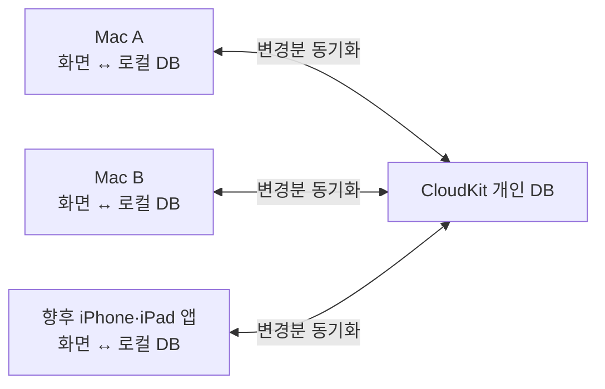

# 할 일 동기화 설계 검토

작성·수정일: 2026-10-24

상태: **설계 검토 / 미구현**

현재 앱은 할 일과 집중 기록을 이 Mac의 `todo-state.json`에 저장하며 계정·동기화 기능을 제공하지 않는다. 이 노트는 여러 기기로 확장할 때의 저장 구조와 데이터 보호 과제를 정리한다. 아래 설계는 검토 중이며 출시 약속이나 확정 명세가 아니다.

## 1. 검토 범위

- 먼저 **Mac 여러 대**에서 할 일을 동기화한다.
- 이후 **iPhone/iPad** 사용으로 확장하는 방향을 생각한다.
- 우선 대상은 **할 일**이며, 갤러리와 이미지 자산은 이번 범위에서 제외한다.
- 로컬에서 먼저 저장·동작하는 **local first** 구조를 우선 검토한다.

별도 회원가입, CloudKit 채택, 미리 알림 연동 여부, 집중 기록의 동기화 범위는 아직 결정하지 않았다.

## 2. 설계 쟁점과 우선 후보

| 쟁점 | 우선 후보 | 남은 결정 |
|---|---|---|
| 할 일의 원본을 어디에 둘까? | TypingPet 자체 데이터 모델과 로컬 DB | 미리 알림을 원본으로 삼을 필요가 있는지 |
| 동기화 저장소는? | Apple 기기 중심이므로 CloudKit 개인 DB 우선 검토 | 실제 배포 앱의 동기화 POC 결과 |
| 앱 자체 계정이 필요한가? | 첫 버전은 별도 회원가입 없이 시작 | 향후 공유·다른 OS·서비스 계정 필요성 |
| 로그인하지 않으면? | 모든 기본 기능을 이 Mac에서 사용 | 동기화 활성화 시 기존 데이터 합치기 흐름 |
| 미리 알림과 연결할까? | 첫 버전에서는 분리하고 후속 연동으로 검토 | iPhone 앱 이전에 기본 미리 알림 앱을 써야 하는지 |
| 집중 타이머도 동기화할까? | 실행 상태는 기기별 보관 | 종료된 집중 기록을 첫 버전에 포함할지 |
| 충돌은 어떻게 처리할까? | 필드별 병합, 변경 이력, 삭제 복구를 설계 | 정확한 충돌 판정·우선순위·이력 보관 방식 |
| 백업 키가 필요한가? | 로그인과 분리하고 백업 복구 용도로 검토 | 암호화 백업 파일과 복구 UX의 범위 |

## 3. 미리 알림과 자체 DB 비교

여기서 **자체 DB**는 반드시 자체 서버를 뜻하지 않는다. 각 기기의 로컬 DB에 TypingPet 모델을 저장하고, CloudKit으로 동기화하는 선택도 가능하다.

| 후보 | 장점 | 고려할 점 |
|---|---|---|
| 미리 알림을 원본으로 사용 | 기존 미리 알림 앱과 같은 데이터를 사용할 수 있음 | TypingPet의 집중 세션·시간 기록 등은 별도 저장이 필요하며 EventKit 권한과 외부 변경을 처리해야 함 |
| 자체 로컬 DB + CloudKit | Apple 기기 중심의 동기화, 자체 로그인 서버 없이 고유 모델 유지 | iCloud 계정·용량·전송 지연·CloudKit 제약과 배포 설정을 다뤄야 함 |
| 자체 로컬 DB + 자체 서버 DB | 다양한 OS, 여러 로그인 방식, 공유 기능으로 확장하기 쉬움 | 인증·접근 제어·동기화 API·서버 운영·백업까지 관리해야 함 |

현재 검토 범위의 우선 후보는 **자체 로컬 DB + CloudKit**이다. 채택 여부는 실제 배포 앱의 POC 결과로 판단한다.

### 미리 알림 연동은 별도 기능

CloudKit 동기화만 추가해도 TypingPet 할 일이 iPhone의 미리 알림 앱에 표시되는 것은 아니다. iPhone에서 TypingPet 데이터를 직접 다루려면 별도 앱이 필요하다.

iPhone 앱을 제공하기 전에 기본 미리 알림 앱에서 할 일을 추가·완료해야 하는지가 연동의 우선순위를 결정한다. 필요하다면 미리 알림 목록 하나와의 연동을 먼저 검토하고, 그렇지 않다면 자체 데이터 동기화부터 검증한다.

미리 알림 양방향 연동에는 다음 정책이 추가로 필요하다.

- TypingPet 항목과 미리 알림 항목의 대응 및 기기 간 식별
- 같은 항목의 중복 가져오기와 변경 순환 방지
- 외부 앱의 수정·완료·삭제와 반복 작업 처리
- 권한 거부·철회, 목록 제거, 계정 변경 처리
- 제목·완료 상태·기한 등 연결할 필드와 TypingPet 전용 필드의 구분

후속 기능의 출발점으로는 일회성 가져오기를 먼저 검토하고, 지속적인 양방향 연동은 별도로 설계할 수 있다.

## 4. 유저·로그인·백업 키의 역할

| 방식 | 역할과 검토 의견 |
|---|---|
| Guest / 로그인하지 않음 | 기본 상태. 로컬에서 할 일과 타이머 사용. 화면에는 `이 Mac에서만 사용`처럼 표현하는 안을 추천 |
| iCloud 동기화 | 기기에 설정된 iCloud 계정을 이용해 같은 계정의 기기끼리 동기화. 첫 버전의 우선 후보 |
| Apple 로그인 | 자체 서비스 계정의 인증 수단. iCloud 동기화와는 별개의 기능 |
| Google 로그인 | 자체 계정·서버를 도입할 때 검토할 인증 수단 |
| 네이버·카카오 로그인 | 실제 사용자 요구가 확인되면 검토. 첫 버전에 모두 넣을 필요는 없음 |
| 이메일 인증 | 자체 계정의 로그인·복구 수단으로 검토 가능. 메일 발송과 계정 복구 운영이 필요 |
| 자체 비밀번호 계정 | 비밀번호 관리와 복구까지 담당해야 하므로 첫 버전에서는 보류 추천 |
| 백업 키 | 로그인 수단, 암호화 키, 복구 키 중 어떤 역할인지 먼저 구분. 초기에는 암호화 백업 파일의 복구 수단으로 검토 |

### 첫 버전의 계정 모델 후보

- 사용 상태는 `이 Mac에서만 사용`과 `iCloud로 동기화`로 구분한다.
- 앱 자체 회원 서버와 비밀번호는 두지 않는 방향을 우선 검토한다.
- `todoID`는 기기 간 공유하는 항목 UUID로 유지한다.
- `deviceID`는 변경을 만든 앱 설치본의 임의 식별자로 사용한다. 사용자 계정이나 하드웨어 식별자와 혼동하지 않는다.
- 로컬 전용 데이터 영역과 iCloud 계정에 연결된 데이터 영역을 구분한다.

나중에 자체 회원 계정이 필요해지면 내부 `userID`에 여러 로그인 수단을 연결하는 구조를 검토한다. 이메일 주소가 같다는 이유만으로 서로 다른 로그인 계정을 자동 병합하지 않는다.

## 5. 로컬 우선 구조 후보

### 기본 원칙

- UI는 로컬 저장소를 읽고 쓴다. 추가·수정·완료 시 네트워크 응답을 기다리지 않는다.
- 로컬 저장 성공과 클라우드 반영 성공을 구분한다.
- 미전송 변경은 앱 재시작과 네트워크 장애 뒤에도 보존한다.
- 기기 사이에서는 레코드의 변경을 동기화한다. JSON이나 SQLite 파일을 공유 폴더에서 통째로 덮어쓰는 방식으로 설계하지 않는다.
- 같은 변경의 재전송이 중복 항목이나 중복 기록을 만들지 않아야 한다.
- `이 Mac에 저장됨`, `전송 대기`, `최근 전송 완료`, `문제 발생`처럼 상태를 구분한다. 한 기기의 전송 완료를 모든 기기의 수신 완료라고 표시하지 않는다.

### 저장 기술 후보

현재 프로젝트는 macOS 13 이상을 지원한다. 우선 후보는 **Core Data의 SQLite 저장소 + `NSPersistentCloudKitContainer`**다. 로컬 전용 저장소와 CloudKit 연결 저장소를 나누는 방식도 검토한다.

CloudKit 전송 시점은 시스템이 조절하므로 즉시 반영을 보장하는 제품으로 설명하지 않는다. 이 구성을 채택한다면 전송용 변경 추적·스케줄링을 별도로 중복 구현하기보다 프레임워크의 기능을 활용한다.

더 세밀한 전송·충돌 제어가 필요하다면 자체 로컬 저장소와 `CKSyncEngine` 조합도 후보지만, `CKSyncEngine`은 macOS 14 이상이므로 현재 지원 범위와 함께 결정해야 한다.

## 6. 현재 구조에서 분리할 데이터

현재 구현 근거:

- [TodoState.swift](../Sources/TypingPet/TodoState.swift): 할 일, 집중 세션, 활성 세션 ID를 하나의 상태로 보관한다. 항목 UUID와 `deletedAt`이 있으며 활성 세션은 최대 하나라고 검증한다.
- [TodoStore.swift](../Sources/TypingPet/TodoStore.swift): 상태를 `todo-state.json`으로 원자적으로 저장한다.
- [FocusTimerEngine.swift](../Sources/TypingPet/FocusTimerEngine.swift): 기기의 monotonic time으로 집중 시간을 측정한다.
- [현재 할 일 기능 문서](todos.md): 저장·복구·체크포인트와 화면 설정의 동작을 설명한다.

이 상태 전체를 여러 기기에서 그대로 합치면 각 기기의 활성 세션이 충돌할 수 있다. 다음처럼 역할을 나누는 안을 추천한다.

| 데이터 | 첫 버전의 동기화 범위 제안 |
|---|---|
| 할 일 ID·제목·생성일 | 동기화 |
| 완료·완료 되돌리기·삭제 표시 | 동기화 |
| 할 일별 타이머 기본 모드·시간 | 동기화 |
| 실행 중인 타이머·일시정지·자리 비움 상태 | 기기별 보관 |
| 종료된 집중 세션 기록 | 후속 단계 후보. 첫 버전 포함 여부는 미정 |
| 창 위치·크기·투명도 등 화면 설정 | 우선 기기별 보관 |
| 갤러리·이미지 자산 | 이번 범위 제외 |

타이머의 매초 변화나 로컬 체크포인트를 그대로 클라우드에 올리지 않는다. 종료된 세션을 동기화한다면 세션 ID로 중복을 제거하고 누적 시간은 기록에서 계산한다.

다른 기기에서 완료·삭제된 할 일을 수신했을 때, 관련 로컬 타이머를 어떻게 종료하고 측정 시간을 보존할지도 정해야 한다. 오프라인 기기는 해당 변경을 받기 전까지 계속 실행될 수 있다.

## 7. 충돌 처리 정책 초안

아래는 **제품이 원하는 결과**이며, 선택한 프레임워크가 모두 자동으로 제공하는 기능은 아니다.

| 상황 | 정책 제안 |
|---|---|
| 서로 다른 할 일 추가 | UUID가 다른 항목을 모두 유지 |
| 같은 항목의 서로 다른 필드 수정 | 각 필드의 변경을 모두 유지 |
| 같은 제목을 동시에 수정 | 모든 기기에서 같은 값을 선택하고 다른 값은 변경 이력에서 복구 가능하게 보관 |
| 완료와 미완료가 충돌 | 앞선 변경을 보고 수행한 후속 수정은 우선. 실제 동시 충돌이면 완료 우선이라는 안을 검토 |
| 삭제와 수정이 충돌 | 삭제 상태를 유지하되 수정 내용을 복구 이력에 보관 |
| 같은 변경이 재전송됨 | 같은 변경 ID는 한 번만 반영 |

### 구현 전에 검증할 사항

- 기본 `NSPersistentCloudKitContainer`의 last-writer-wins 처리만으로 위 정책을 보장할 수 있다고 가정하지 않는다.
- `updatedAt` 하나에만 의존하지 않는다. 기기 시계 차이를 고려해 변경 ID·기준 버전·변경 이력의 필요 범위를 정한다.
- 제목 이력을 별도 레코드로 보관하는 방식과, 명시적인 변경 기록을 기반으로 상태를 계산하는 방식의 복잡도를 비교한다.
- 앱의 UUID만 같다고 Core Data/CloudKit이 자동으로 같은 항목으로 취급한다고 가정하지 않는다. 마이그레이션·복원·재시도의 중복 제거를 검증한다.
- 삭제 흔적을 언제 정리할지 정한다. 오래 오프라인이었던 기기가 삭제된 항목을 되살리지 않아야 한다.
- 처음부터 범용 CRDT를 구현하는 것을 기본 전제로 삼지는 않는다. POC에서 필요한 복잡도를 판단한다.

## 8. 연결·해제·계정 변경

### 처음 iCloud를 켤 때

- 로컬 데이터와 기존 iCloud 데이터를 확인하고 합치기 동작을 안내한다.
- 기존 UUID를 유지하고, 같은 가져오기·마이그레이션을 반복해도 중복되지 않아야 한다.
- 마이그레이션 전에 원본 JSON을 복구 가능한 형태로 보관한다.
- 로컬 전용 상태에서 동기화 상태로 옮기는 절차가 중간에 실패해도 다시 진행할 수 있어야 한다.

### 동기화를 끌 때

- 동기화 해제와 클라우드 데이터 삭제를 별도 동작으로 구분한다.
- 이 Mac에 복사본을 남길지, 미전송 변경은 어떻게 다룰지 정한다.
- 다시 켰을 때 오래된 복사본을 새 수정으로 간주해 덮어쓰지 않도록 한다.

### iCloud 계정이 A에서 B로 바뀔 때

- A의 로컬 데이터·미전송 변경을 B에 자동 업로드하지 않는다.
- 저장 영역과 전송 상태를 계정별로 분리한다.
- 로그인 상태 변화와 일시적인 네트워크 장애를 구분한다.
- 기존 데이터의 보관·내보내기·로컬 사용 전환 방식을 결정한다.

## 9. 백업·복구·개인정보

동기화는 삭제나 잘못된 수정도 전파하므로 백업과 구분한다.

검토할 기능:

- 날짜별 로컬 백업과 수동 내보내기·가져오기
- 기존 JSON 형식의 마이그레이션·내보내기 용도 유지
- 암호화 백업 파일과 복구 키의 필요성
- 복원 시 합치기와 대체하기의 구분, 기존 UUID·변경 이력 처리
- 삭제 항목과 제목 변경 이력의 보관 기간

CloudKit 개인 DB를 사용하면 데이터가 사용자의 iCloud 용량에 포함된다. 자체 로그인 서버를 두지 않는 것과 앱 수준의 종단간 암호화를 제공하는 것은 별개의 결정이다. 할 일 내용이 진단 로그에 불필요하게 남지 않도록 하는 정책도 필요하다.

## 10. POC와 완료 기준

전체 구현 전에 두 Mac으로 작은 POC를 진행하는 안을 추천한다.

- [ ] 실제 배포 방식으로 서명한 앱이 두 Mac에서 같은 CloudKit 개인 DB에 접근한다.
- [ ] 한쪽의 추가·수정·완료가 다른 쪽에 반영된다.
- [ ] 양쪽의 오프라인 수정 후 최종 결과가 동일해진다.
- [ ] 같은 제목 수정, 완료 되돌리기, 삭제 대 수정의 결과가 정책과 일치한다.
- [ ] 전송 중 종료·재시작·재시도에도 유실이나 중복이 없다.
- [ ] 장기간 오프라인이었던 기기의 재접속으로 삭제 항목이 부활하지 않는다.
- [ ] iCloud 계정 변경 시 데이터와 미전송 변경이 섞이지 않는다.
- [ ] 원본 JSON을 반복 마이그레이션해도 중복되지 않으며 원본 복구가 가능하다.
- [ ] iCloud를 사용할 수 없어도 로컬 저장과 타이머가 정상 동작한다.
- [ ] 다른 기기의 완료·삭제를 수신할 때 측정한 집중 시간이 보존된다.
- [ ] 개발용과 배포용 앱의 로컬 저장소·CloudKit 환경이 의도대로 분리된다.

Developer ID 배포에서도 CloudKit 사용이 가능하지만, 현재 빌드·배포 과정에 필요한 entitlements와 provisioning profile, 리소스 구성을 추가해야 한다. 개발 실행만으로 완료로 판단하지 않고, **다른 Mac에서 다운로드한 실제 배포 ZIP의 동기화**까지 확인한다.

## 11. 열린 설계 결정

1. iPhone 앱 이전에 기본 미리 알림 앱으로 할 일을 관리할 필요가 있는가?
2. 첫 버전에서 자체 회원가입 없이 iCloud 동기화만 제공해도 되는가?
3. 첫 동기화 범위를 할 일 기본 데이터로 제한할까, 종료된 집중 기록까지 포함할까?
4. macOS 13 지원을 유지할까? 저장·동기화 기술 선택에 어떤 제약이 있는가?
5. 동시 제목 수정·완료 되돌리기·삭제 복구의 사용자 경험을 어떻게 정할까?
6. iCloud 활성화·해제·계정 변경과 백업 복원의 데이터를 어떻게 합칠까?
7. 위 결정을 검증할 POC의 최소 모델과 테스트 시나리오는 무엇인가?

후속 후보는 종료된 집중 기록, iPhone/iPad 앱, 미리 알림 연동이며 갤러리·이미지 동기화는 별도 기획으로 다룬다. 자체 계정이나 다른 OS 확장이 필요해지면 인증과 서버 구성도 다시 비교한다.

## 참고 자료

초기 설계에서 참고한 Apple 공식 자료다. 구현·발행 시점에는 지원 범위와 설정 요구사항을 다시 확인한다.

- [Core Data와 CloudKit 구성](https://developer.apple.com/documentation/CoreData/setting-up-core-data-with-cloudkit)
- [CloudKit 개인 DB](https://developer.apple.com/documentation/cloudkit/ckcontainer/privateclouddatabase)
- [Core Data와 CloudKit 동기화 시점·진단](https://developer.apple.com/documentation/technotes/tn3164-debugging-the-synchronization-of-nspersistentcloudkitcontainer)
- [Core Data와 CloudKit의 충돌 처리·데이터 모델링](https://developer.apple.com/videos/play/wwdc2019/202/)
- [CKSyncEngine 소개](https://developer.apple.com/videos/play/wwdc2023/10188/)
- [EventKit의 미리 알림 접근 권한](https://developer.apple.com/documentation/EventKit/EKEventStore/requestFullAccessToReminders%28completion%3A%29)
- [Developer ID와 CloudKit 등 고급 기능](https://developer.apple.com/help/account/certificates/create-developer-id-certificates/)
