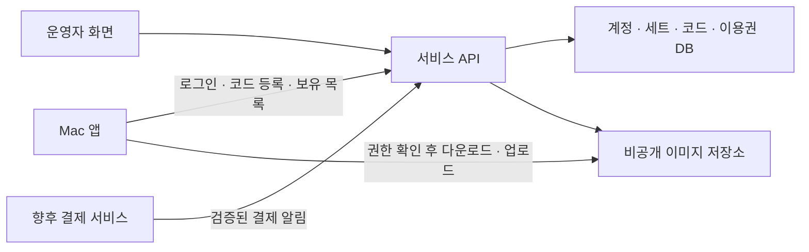

# 펫 세트 서버 관리·코드 등록·유료화 기획

작성일: 2026-10-24  
상태: **기획 초안 / 구현 전**

기본 세트 외의 펫 세트를 서버에서 관리하고, 코드 등록으로 특정 세트를 받을 수 있게 한다. 이후 세트 코드 판매와 소액의 커스텀 기능 해제를 연결한다. 사용자 요구와 아래 추천 정책을 구분하며, 가격·계정·용량 등 추천 수치는 출시 확정 사항이 아니다.

## 1. 사용자가 정한 방향과 추천안

| 항목 | 사용자 요구 | 이번 기획의 추천안 |
|---|---|---|
| 기본 세트 | 별도 취급 | 앱에 포함. 로그인·서버 연결 없이 사용 |
| 추가 세트 | 우선 서버에서만 관리 | 공식 세트와 개인 커스텀 세트의 원본·메타데이터·배포 권한을 서버에서 관리 |
| 세트 획득 | 지정 양식의 코드 입력 | 코드 등록 → 계정에 이용권 부여 → 내려받기 → 적용 |
| 코드 양식 | `TYPING-PET-XXXX-XXXX` | 각 X는 대문자 알파벳 또는 숫자 |
| 세트 가격 | 자유롭게 가격 설정 가능 | 세트별 무료·유료 정책. 판매 가격과 코드 등록 기능을 분리 |
| 커스텀 기능 | 약 US$1–3의 소액 | 계정당 1회 US$1.99 후보. 이미지마다 과금하지 않음 |
| 당장 할 일 | 기획 구체화 | 문서화 후 무료 테스트 코드로 작은 POC부터 검증 |

**핵심 개념: 코드는 이용권을 받는 수단이고, 등록 후의 사용 권한은 계정에 남는다.** 같은 세트에 여러 코드를 발급할 수 있다. 세트 구매와 커스텀 기능 구매는 서로 독립적이다.

## 2. ‘서버에서만 관리’의 범위

이번 초안은 기본 외의 **개인 커스텀 세트도 서버 관리 대상**으로 해석한다. 이를 로컬 전용으로 남기려면 별도 제품 결정이 필요하다.

| 대상 | 원본·관리 위치 | 앱에 남는 것 |
|---|---|---|
| 기본 세트 | 앱 번들 | 기본 이미지 |
| 공식 추가 세트 | 운영자 서버 | 검증된 내려받기 복사본, 적용 상태 |
| 개인 커스텀 세트 | 해당 계정의 비공개 서버 영역 | 업로드 중 임시 파일, 검증된 내려받기 복사본 |
| 이용권·등록 이력 | 서버 | 오프라인 사용용 서명된 권한 정보 |
| 선택·정렬·창 위치 | 이 Mac의 설정 | 사용자 화면 설정 |

- 앱 릴리스에 추가 세트 전체나 코드 매칭 목록을 넣지 않는다. 세트 추가·수정에 앱 재배포가 필요하지 않아야 한다.
- 공식 세트의 이름·이미지·버전은 운영자가 서버에서 변경한다. 앱에서 공식 원본을 덮어쓰지 않는다.
- 개인 세트는 사용자가 앱에서 편집하되, 저장 완료는 서버가 검증·확정한 시점이다. 오프라인에서는 신규 생성·편집을 완료할 수 없다.
- 선택한 원본 파일은 업로드 입력으로 사용한다. 업로드 성공 후에는 서버 버전을 기준으로 사용하며, 사용자가 고른 원본 파일을 삭제하거나 이동하지 않는다.
'- 네트워크가 끊겨도 설치 완료된 세트는 계속 사용한다. 새 코드 등록·다운로드·복원·업로드에는 연결이 필요하다.
- 개인 세트의 업로드는 명시적으로 안내한다. 파일 선택만으로 업로드하지 않고 `내 계정에 저장`을 눌렀을 때 전송한다.

이는 원본과 권한을 서버가 관리한다는 뜻이다. Mac에 표시할 이미지 복사본이 전혀 남지 않는 구조나 복제 방지를 보장하는 구조는 아니다.

## 3. 사용자 화면과 주요 흐름

설정의 기존 `갤러리`를 `펫`으로 정리하는 안을 추천한다. 상단에는 `내 펫`, `코드 등록`, `커스텀 만들기`를 두고 계정 메뉴에 `구매·등록 내역`과 `복원`을 둔다. 결제가 준비되기 전에는 구매 버튼을 노출하지 않는다.

### 내 펫

- 기본 세트, 등록한 공식 세트, 비공개 개인 세트를 카드로 보여 준다.
- 카드에는 미리보기·이름·제작자·`사용 중`·`다운로드 필요`·`업데이트 있음` 등을 표시한다.
- 상세 화면에서 대기 이미지와 반응 이미지들을 키 입력 미리보기로 확인한다. 시험 입력은 창 안에서만 처리한다.
- 설치된 세트는 `적용`, 미설치 세트는 `다운로드 후 적용`을 주 동작으로 제공한다.
- 검색·즐겨찾기·최근 사용 정렬은 보유 세트가 늘 때 추가한다. 첫 버전은 사용 중인 세트를 맨 앞에 보여 준다.
- 공식 세트의 `이 Mac에서 지우기`는 다운로드 복사본만 제거한다. 보유 목록과 이용권은 유지한다.
- 개인 세트의 `서버에서 삭제`는 별도 동작이다. 다른 Mac에서도 사용할 수 없게 된다는 설명과 확인을 제공한다.

### 코드 등록

1. `코드 등록`을 누르고 코드를 붙여넣거나 입력한다. 로그인 전에도 입력은 가능하다.
2. 등록할 때만 로그인한다. 로그인 왕복 중 입력값은 메모리에서 유지하고 로그에는 남기지 않는다.
3. 서버에서 확인한 세트 이름·미리보기 또는 해제 기능을 보여 준다. 확인만으로 코드를 소진하지 않는다.
4. `내 계정에 등록`을 누르면 코드 소비와 이용권 부여를 한 번에 확정한다.
5. 성공 후 `다운로드 후 적용`을 제공한다. 기존 펫은 새 세트 검증이 끝날 때까지 유지한다.

추천 문구:

| 상황 | 표시·동작 |
|---|---|
| 형식 오류 | `TYPING-PET-AB12-CD34 형식으로 입력해 주세요.` |
| 확인 성공 | `‘우주 고양이’ 세트를 내 계정에 등록합니다.` |
| 본인이 이미 등록한 코드 | `이미 등록한 펫입니다.` → 내 펫으로 이동 |
| 같은 세트를 이미 보유 | `이미 보유한 펫입니다. 이 코드는 사용하지 않았습니다.` |
| 존재하지 않음·다른 계정 사용·만료·중지 | `등록할 수 없는 코드입니다. 코드를 확인하거나 문의해 주세요.` |
| 일시적인 서버 장애 | `지금은 확인할 수 없습니다. 잠시 후 다시 시도해 주세요.` |
| 등록 성공 뒤 다운로드 실패 | `등록은 완료되었습니다. 다운로드를 다시 시도해 주세요.` |

다른 계정의 정보나 코드 존재 여부를 불필요하게 노출하지 않는다. 운영자에게는 내부 코드 ID로 정확한 사유를 보여 준다. 미리보기 이후 다른 사람이 먼저 등록한 경우에는 최종 등록 시 실패할 수 있음을 처리한다.

### 커스텀 만들기

1. 잠긴 상태에서는 기능·가격·서버 업로드·저장 한도를 먼저 설명한다.
2. 기능을 해제한 사용자는 `이미지 선택` 또는 `폴더 가져오기`로 시작한다.
3. 대기 이미지 1장과 반응 이미지 1장 이상을 지정하고 이름을 붙인다. 한 장을 두 역할에 함께 쓸 수 있다.
4. 크기·여백·반응을 미리 본 뒤 `내 계정에 저장`을 누른다.
5. 서버가 파일을 검증하고 비공개 세트 버전을 확정하면 내려받아 적용한다.

권한이 없을 때 이미지 선택창까지 진행시킨 뒤 결제를 요구하지 않는다. 공식 세트를 그대로 사용하는 데에는 커스텀 기능 구매가 필요 없다.

## 4. 코드 정책

```text
TYPING-PET-AB12-CD34
^TYPING-PET-[A-Z0-9]{4}-[A-Z0-9]{4}$
```

- 정규 형식은 위 양식이다. 소문자 붙여넣기는 대문자로 바꾸고 앞뒤 공백을 제거한다. 하이픈 자동 삽입을 지원한다.
- `O`와 `0`, `I`와 `1`을 서로 같은 값으로 치환하지 않는다. 발급 시 혼동하기 쉬운 문자를 제외하는 것은 선택 사항이다.
- 코드에는 세트 ID·가격·사용자·권한을 인코딩하지 않는다. 서버의 코드 레코드가 대상을 결정한다.
- 발급 완료된 코드의 대상을 나중에 다른 상품으로 바꾸지 않는다. 잘못 발급했다면 중지하고 새 코드로 대체한다.
- 첫 버전은 **코드 1개 → 세트 1개 또는 커스텀 기능 1개 → 계정 1개**로 제한한다.
- 같은 세트에 서로 다른 일회용 코드를 여러 개 발급할 수 있다. 무료 테스트 배포에도 같은 등록 경로를 사용한다.
- 등록된 코드는 다른 계정에 양도할 수 없다. 미등록 코드는 선물로 전달할 수 있다.
- 유료 코드는 기본적으로 등록 기한을 두지 않는 안을 추천한다. 이벤트 코드의 등록 기한은 등록 이후 세트 이용 기간과 별도 필드로 둔다.
- 묶음 상품·다회용 공개 이벤트 코드·등록 후 선물 이전은 후속 기능으로 남긴다.

### 발급과 보호

36개 문자 전체를 쓰면 임의 부분은 `36^8 = 2,821,109,907,456`가지, 약 41.4비트다. 코드 자체를 장기 인증 토큰으로 사용하지 않고 **로그인 후 온라인 등록에만** 사용한다.

- 암호학적 난수로 생성하고, 서버의 유일성 제약에 충돌하면 재생성한다.
- 검증 DB에는 코드 원문 대신 서버 비밀키를 이용한 HMAC을 저장한다. 비밀키는 DB와 분리하고 교체·복구 방법을 마련한다.
- 코드 확인·등록 모두 계정/IP별 시도 제한과 전체 서비스 한도를 적용한다. IP 제한만으로 공유망 사용자를 과도하게 막지 않는다.
- 원문은 URL·접속 로그·분석 이벤트·오류 수집에 넣지 않는다. 요청 본문도 로그 수집에서 제외한다.
- 로그인 세션과 다운로드 인증에는 별도의 충분히 긴 임의 토큰을 사용하고 Keychain에 보관한다.
- 원문을 다시 전달해야 하는 결제 시스템에는 별도의 암호화된 전달용 보관과 삭제 기한이 필요하다. HMAC만으로 원문을 복원할 수는 없다.

운영자 수동 발급은 발급 직후 한 번 안전하게 내려받게 하는 방식부터 시작한다. 미등록 코드 분실은 기존 코드를 중지하고 재발급한다. 자동 판매에서는 결제 재시도·전달 실패에도 같은 주문에서 여러 유효 코드가 생기지 않게 설계한다.

## 5. 계정·복원·오프라인 사용

기본 세트는 계정 없이 사용한다. **추가 세트를 등록하거나 커스텀 기능을 이용할 때부터 복구 가능한 계정**을 요구하는 안을 추천한다. 설치 ID만 소유자로 사용하면 재설치·Mac 교체·환불 지원이 어려워진다.

- 내부 `userID`를 기준으로 이용권을 저장한다. 로그인은 이메일 링크 방식 등을 후보로 두고 실제 제공자는 별도로 결정한다.
- 코드가 로그인 수단이 되지 않게 한다. 코드를 잃어도 계정에 등록된 세트는 복원할 수 있다.
- 같은 계정의 여러 Mac에서 보유 목록을 불러오고 필요한 세트만 내려받는다. 초기에는 강제 기기 수 제한을 두지 않는 안을 추천한다.
- 할 일의 iCloud 동기화 계정과 이미지 서비스의 계정은 별개다. 펫 서비스 로그인이 할 일 업로드나 iCloud 데이터 연결을 뜻하지 않는다. [할 일 동기화 기획](TODO_SYNC_PLANNING.md)과 범위를 분리한다.
- 계정 변경·로그아웃 시 개인 캐시와 권한 정보를 계정별로 분리하고 기본 세트로 전환한다. A 계정의 이미지를 B 계정 화면에 노출하지 않는다.
- 서버 장애나 인증 갱신 실패만으로 로그아웃시키거나 기존 펫을 즉시 잠그지 않는다. 명시적인 로그아웃과 일시적인 연결 문제를 구분한다.

서버에서 서명한 권한 정보와 검증된 이미지 복사본으로 오프라인 표시를 허용한다. 서버가 권한 해제를 확정해 전달했을 때 적용하며, 확인 실패를 권한 해제로 취급하지 않는다.

**이 정책에서는 환불·회수 이후에도 계속 오프라인인 Mac의 사용을 즉시 중단시킬 수 없다.** 첫 버전은 이 한계를 수용하고 주기적인 강제 온라인 인증을 도입하지 않는 안을 추천한다.

## 6. 유료 상품과 가격

| 상품 | 얻는 것 | 가격·결제 방식 초안 |
|---|---|---|
| 기본 펫 | 기본 이미지와 앱 기본 기능 | 무료 |
| 공식 세트 코드 | 지정 세트를 계정에 등록하는 권리 | 세트별 자유 설정. 무료 배포·정가·원하는 금액 방식 중 선택 |
| 커스텀 기능 | 개인 세트 생성·이미지 추가·수정 | 계정당 1회 US$1.99 후보, 검토 범위 US$1–3 |

- 공식 세트를 구매했다고 커스텀 기능이 자동 해제되지는 않는다. 커스텀 기능을 샀다고 모든 공식 세트를 받을 수도 없다.
- 커스텀 기능의 과금 단위는 기능 해제 1회다. 이미지 한 장, 세트 한 개, Mac 한 대마다 다시 과금하지 않는 안을 추천한다.
- 기능 해제 코드를 발급할 수도 있다. 일반 사용자는 결제 완료 후 자동으로 계정에 반영되게 하여 코드 입력을 줄이는 안을 추천한다.
- 구매 화면에 통화·실제 결제 총액·제공 범위·보관 한도·복원 방법을 표시한다. 가격 변경은 기존 등록 권한을 바꾸지 않는다.

### 소액 과금과 서버 보관의 균형

1회 소액 결제로 무제한 업로드와 무기한 서버 운영을 약속하지 않는다. 아래는 POC용 한도 후보이며 실제 이미지 크기·변환 결과·운영비를 측정한 후 정한다.

| 항목 | 초기 후보 |
|---|---|
| 개인 세트 수 | 계정당 10개 |
| 개인 저장 공간 | 원본·변환본·보관 중인 버전을 합쳐 100MB |
| 세트별 이미지 수 | 최대 50장 |
| 개별 입력 파일 | 최대 10MB, 해상도 최대 4096×4096 |
| 이미지 형식 | 기존 가져오기 형식의 호환성 검증 후 서버에서 정규화. 첫 출시의 애니메이션 편집은 제외 |

용량 초과 시 기존 세트 사용은 유지하고 신규 저장을 안내한다. 확장 용량·추가 결제·구독은 실제 사용량이 확인된 뒤 검토한다. 서비스 종료 시 사전 고지와 개인 원본 내보내기 경로도 출시 정책에 포함한다.

### 판매 채널과 결제 확인

현재 프로젝트의 [Developer ID 직접 배포](RELEASE.md)를 첫 출시 기준으로 한다. 결제 사업자는 아직 선택하지 않는다. 소액 결제의 고정 수수료·정산 가능 국가/통화·환불 비용과 운영 부담을 확인한 뒤 선택한다.

App Store 심사 지침 3.1.1은 디지털 콘텐츠·기능 해제에 인앱 결제를 요구하고 자체 라이선스 키 방식에 제약을 둔다. Mac App Store 항목 2.4.5에도 라이선스 키·자체 복제 방지 관련 제한이 있다. **향후 App Store 버전에서는 이 코드 판매·해제 흐름을 그대로 재사용할 수 있다고 가정하지 않는다.** 채널별 결제 결과를 내부 이용권으로 연결하는 설계는 검토할 수 있지만, 각 채널의 승인 조건은 별도로 확인해야 한다. [Apple 심사 지침](https://developer.apple.com/app-store/review/guidelines/#in-app-purchase)

자동 결제를 붙일 때는 브라우저의 결제 성공 화면만으로 코드나 이용권을 발급하지 않는다. 서버가 서명 검증된 결제 알림과 주문의 상품·금액·통화를 확인한 뒤 발급한다. 같은 알림이 반복돼도 주문당 발급 결과는 하나다.

## 7. 운영자 관리 화면

일상 관리는 파일 경로나 DB 수정보다 **세트 / 코드 / 사용자·이용권 / 주문·처리 이력** 화면으로 수행하게 한다. 공개 앱의 로그인과 운영자 접근 권한은 분리한다.

| 화면 | 첫 버전에서 필요한 동작 |
|---|---|
| 세트 목록 | 썸네일, 이름, 제작자, 버전, 공개 상태, 연결된 상품, 등록 수로 검색·정렬 |
| 세트 편집 | 이미지 업로드, 대기/반응 지정, 순서 조절, 미리보기, 라이선스·제작자 기록 |
| 게시 | `초안 → 검증 완료 → 게시`. 게시 전에 실제 앱과 같은 방식으로 미리보기 |
| 버전 관리 | 기존 버전을 덮어쓰지 않고 새 버전 게시. 문제 버전 신규 배포 중지·이전 버전으로 복구 |
| 코드 발급 | 대상 세트 또는 기능, 개수, 캠페인 메모, 등록 기한 설정. 발급 전 대상·개수 확인 |
| 코드 조회 | 원문 대신 내부 ID·발급 묶음·상태·등록 계정·주문으로 조회. 중지·미등록 코드 재발급 |
| 사용자 지원 | 보유 세트·기능·등록/환불 이력 확인. 사유를 남기고 지급·회수 |
| 주문 | 결제 확인, 전달 실패, 재처리, 환불 상태를 분리해 표시 |

게시된 세트의 단순 판매 중지는 기존 구매자의 권한 회수가 아니다. 운영자 변경은 수행자·시점·사유를 남긴다. 대량 발급과 권한 회수에는 구체적인 대상·영향을 확인하는 화면을 둔다.

개인 세트는 기본 비공개이며 운영자 카탈로그에 자동 게시하지 않는다. 운영자의 원본 열람도 일반 목록 동작과 분리하고 사용자 지원에 필요한 범위로 제한한다. 사용자 간 공유·재판매·창작자 정산은 첫 범위에서 제외한다.

## 8. 서버 구성과 최소 데이터



그림의 저장소 접근도 API 또는 만료되는 접근 권한을 거친다. 앱에 공개된 고정 파일 주소만으로 유료 원본을 내려받을 수 있게 하지 않는다.

현재 `pet.miel.ing`은 `/update/` 정적 업데이트 파일만 제공한다. 이번에 로컬 nginx 설정도 읽어 확인했다. 이 정적 디렉터리에 유료 세트나 개인 원본을 넣으면 안 된다. 기존 업데이트 경로는 유지하고, 신규 서비스 API와 비공개 파일 영역을 별도로 설계한다. 신규 API의 공개 접근 검증은 구현 단계에서 수행한다.

첫 규모에서는 서비스 API 1개, 관계형 DB, 비공개 파일 저장소면 충분하다. 단일 서버 SQLite 또는 PostgreSQL은 동시 쓰기·백업·운영 방식에 따라 선택한다. DB와 이미지 파일이 함께 복구되는 백업 절차가 필요하다.

| 데이터 | 핵심 필드·제약 |
|---|---|
| 계정 | `userID`, 로그인 연결, 상태 |
| 펫 세트 | `packID`, 공식/개인 구분, 개인 소유자, 이름, 제작자·라이선스, 게시 상태 |
| 세트 버전 | `packID`, 불변 `version`, 파일 목록·해시·크기, 호환 최소 앱 버전 |
| 상품 | `productID`, 세트 또는 기능 대상, 가격 정책·통화, 판매 상태 |
| 코드 | `codeID`, HMAC 유일값, 불변 대상, 발급 묶음, 상태·등록 기한, 주문 참조 |
| 등록 기록 | `codeID`, `userID`, 확정 시각. 첫 버전은 코드당 최대 1계정 |
| 이용권 | `userID`, 대상, 부여 출처·시각, 유효/회수 상태. 같은 대상의 유효 출처를 계산 |
| 주문 | 외부 결제 ID 유일값, 검증된 금액·통화, 발급·환불 상태 |
| 관리 이력 | 수행자, 대상, 변경 내용·사유. 코드 원문·이미지 본문은 제외 |

코드 상태, 세트 게시 상태, 상품 판매 상태, 이용권 상태를 서로 분리한다. 같은 대상에 관리 지급 등 다른 유효 권한이 남아 있다면 한 주문 환불만으로 전부 회수하지 않는다.

API 역할 초안:

- 로그인·세션 갱신과 `내 보유 세트/기능` 조회
- 코드 미리보기와 코드 등록: 원문은 HTTPS 요청 본문으로만 전달
- 권한 확인 후 특정 버전 다운로드 허용
- 커스텀 기능·소유자·용량을 확인한 업로드 시작 및 확정
- 개인 세트 이름·이미지 수정과 삭제
- 향후 결제 알림 수신 및 주문 조회

코드 등록은 DB 트랜잭션에서 조건부 소비와 이용권 부여를 함께 처리한다. 동시 등록은 한 계정만 성공하고, 같은 계정의 재시도는 기존 성공 결과를 반환한다. 이미 보유한 대상의 새 코드는 소비하지 않는다. 응답 유실·다운로드 실패 때문에 이용권이 사라지거나 코드가 중복 발급되어서는 안 된다.

## 9. 이미지 배포·편집·키 반응

- 공식 세트는 `packID + version`으로 식별하며 게시된 파일을 덮어쓰지 않는다. 개인 세트 편집도 새 서버 버전을 만든다.
- 패키지 명세에는 대기/반응 역할, 안정적인 이미지 ID, 파일명, 크기, 해시, 최소 앱 버전을 둔다. 제작자·이용 조건도 함께 관리한다.
- 서버 명세의 진위를 검증하고 파일 크기·해시를 확인한다. 명세 서명을 도입한다면 앱 업데이트 서명 키와 분리한다.
- 실행 코드·스크립트는 포함하지 않는다. 확장자 외에 실제 이미지 디코딩, 해상도·메모리·전체 크기를 검증한다.
- ZIP을 사용하면 경로 이탈·심볼릭 링크·압축 폭탄·과도한 파일 수를 거부한다. 검증이 끝난 임시 폴더만 설치 위치로 원자적으로 전환한다.
- 다운로드·편집 중 실패하면 기존 활성 세트와 마지막 정상 버전을 보존한다. 개인 편집 충돌은 기준 버전을 확인해 덮어쓰기 전에 알린다.
- 개인 업로드는 해당 계정의 기능 권한·소유자·한도를 서버에서 검사한다. 앱의 버튼 잠금만으로 제한하지 않는다.
- 보유한 세트 안의 이미지를 특정 키에 연결하는 것은 기본 키 반응 기능으로 둔다. 외부 이미지를 새로 추가하는 것은 커스텀 기능을 거쳐 비공개 세트에 저장한다.
- 현재 키 반응 규칙은 앱 전체에 적용된다. 서버 세트 도입 시 `세트별 규칙`으로 옮기는 안을 추천한다. 파일 경로 대신 세트/이미지 ID를 참조하고, 새 버전에서 이미지가 없어지면 일반 반응으로 대체한다.
- 공식 세트의 사용자 편집·개인 복제는 이미지 이용 조건까지 고려해야 하므로 첫 범위에서는 제공하지 않는다.

개인 세트의 여러 Mac 편집에는 버전 충돌 처리가 필요하지만, 실행 중인 펫·창 위치·키 입력 기록을 서버로 동기화할 필요는 없다.

## 10. 기존 사용자 전환과 운영 예외

현재 [PetImageLibrary](../Sources/TypingPet/PetImageLibrary.swift)는 기본/사용자 세트를 구분하고 사용자 이미지를 Application Support에 복사한다. [갤러리](../Sources/TypingPet/SettingsWindow.swift)와 [메뉴](../Sources/TypingPet/main.swift) 양쪽에 가져오기 경로가 있고, [키 반응 이미지](../Sources/TypingPet/KeyReactions.swift)는 별도 로컬 저장소를 쓴다. 서버 관리 전환 시 모두 같은 정책을 따라야 한다.

### 기존 무료 커스텀 기능 처리

이미 무료로 사용하던 기능을 바로 잠그거나 기존 파일을 자동 업로드하지 않는 안을 추천한다.

1. 전환 전 세트 목록·이미지·기존 키 반응 규칙을 복구 가능한 형태로 백업한다.
2. 기존 사용자는 로그인과 업로드를 직접 선택한다. 서버 저장 공간과 업로드될 파일을 미리 보여 준다.
3. 기존 이미지 복사를 새 서버 세트로 전환하되 중복 실행·부분 실패를 처리하고, 전환 성공 전에는 원본을 정리하지 않는다.
4. 기존 사용자에게 커스텀 기능 무료 전환 권한을 제공하는 정책을 우선 검토한다. 구형 앱의 로컬 데이터만으로 진짜 기존 사용자임을 강하게 증명하기 어렵다는 한계는 수용 여부를 결정한다.
5. 전환을 원치 않거나 실패한 사용자는 기존 버전을 계속 쓸 수 있게 한다. 신규 버전의 로컬 세트 읽기 유예를 둘지는 별도 결정한다. 유예를 둔다면 서버 전용 원칙의 한시적인 예외로 명시한다.

현재 [MIT 소스 코드](../LICENSE)와 [CC0 기본 이미지](../ASSET_LICENSE.md)의 공개 조건은 유지하는 안을 전제로 한다. 판매용 추가 자산의 이용 조건은 세트별로 관리한다. 서버 권한 검사는 공식 서비스의 발급·저장·다운로드를 통제하며, 사용자가 수정한 앱이나 이미 내려받은 파일의 복제를 완전히 막는다고 약속하지 않는다.

### 예외 정책 초안

| 상황 | 처리 |
|---|---|
| 공식 세트 판매 종료 | 새 판매만 중지. 기존 이용권·재다운로드 유지 |
| 문제 버전 게시 | 신규 다운로드 중지, 정상 버전 복구. 기존 정상 캐시 보존 |
| 미등록 코드 환불 | 코드 중지, 재발급·추가 등록 차단 |
| 등록 후 세트 환불 | 해당 주문의 이용권 출처 회수. 다음 정상 권한 확인 때 반영 |
| 커스텀 기능 환불 | 신규 생성·업로드·편집 권한 회수. 개인 원본 조회·내보내기·삭제는 유지하는 안 |
| 권리 문제로 세트 회수 | 판매 중지와 기존 권한 회수 여부를 분리해 결정하고 대상 사용자에게 설명 |
| 개인 세트 삭제 | 서버 보관 및 백업 삭제 기한 안내. 연결된 Mac 캐시는 다음 동기화 때 정리하며 즉시 원격 삭제는 보장하지 않음 |
| 계정 삭제 | 개인 원본 내보내기 기회, 운영 데이터 삭제 일정, 주문 기록의 별도 보관 범위를 안내 |

추가 서비스는 계정 ID·이용권·등록 기록·개인 이미지와 접속 정보를 처리한다. 키 입력 내용과 할 일 데이터는 전송 대상에 포함하지 않는다. 출시 전에 현재 README의 ‘업데이트 통신만 있음’ 설명을 실제 동작에 맞게 갱신한다.

## 11. 구현 순서와 완료 기준

### 1단계: 무료 코드로 서버 관리 검증

- 복구 가능한 로그인 1개, 공식 테스트 세트 1개, 일회용 코드 발급·등록·보유 목록·재다운로드
- 최소 운영자 화면과 버전 게시/복구
- 앱의 등록·다운로드·적용·복사본 제거·오프라인 사용
- 결제와 개인 업로드 없이 먼저 실제 배포 앱으로 검증

### 2단계: 비공개 커스텀 세트

- 테스트용 기능 해제 코드, 업로드·검증·버전 편집·용량 안내·삭제·내보내기
- 기존 이미지와 키 반응의 동의 기반 전환
- 관리자가 테스트 권한을 지급하여 결제 없이 기능을 검증

### 3단계: 판매 연결

- 실제 수수료·정산 조건을 확인한 결제 서비스 선택
- 세트 코드 판매와 커스텀 기능 결제, 안전한 코드 전달·분실 재발급
- 결제 중복 알림·취소·환불·복원·지원 화면 검증 후 판매 시작

완료 기준:

- [ ] 서버에 세트를 추가·게시하면 앱 재배포 없이 등록·다운로드할 수 있다.
- [ ] 코드 형식·자동 대문자 처리·붙여넣기가 명세와 일치한다.
- [ ] 같은 코드의 동시 등록은 한 계정만 성공하며 같은 계정의 재시도는 중복되지 않는다.
- [ ] 이미 보유한 세트의 다른 코드를 소진하지 않는다.
- [ ] 등록 직후 응답 유실·앱 종료·다운로드 실패에도 이용권을 복원할 수 있다.
- [ ] 같은 계정의 다른 Mac과 재설치한 앱에서 코드 재입력 없이 복원된다.
- [ ] 오프라인·서버 오류에도 기본 세트와 설치 완료된 세트가 동작한다.
- [ ] 소유권 없는 계정이 파일 주소·업로드 API를 직접 호출해도 접근할 수 없다.
- [ ] 개인 세트가 다른 계정에 노출되지 않으며 로그아웃·계정 변경도 검증된다.
- [ ] 손상 패키지·과도한 이미지·경로 이탈을 거부하고 기존 펫을 유지한다.
- [ ] 커스텀 권한 없이 갤러리·메뉴·키 반응 등 다른 경로로 업로드할 수 없다.
- [ ] 기존 이미지 전환은 명시적 동의를 받고 부분 실패·반복 실행에도 원본을 보존한다.
- [ ] 결제 중복 알림·취소·환불·전달 실패에도 발급과 이용권 상태가 일관된다.
- [ ] DB와 파일 백업으로 실제 복구하고 독립적인 외부망에서도 등록·다운로드를 검증한다.

## 12. 구현 전에 확정할 결정

1. **개인 세트까지 서버 원본으로 관리**한다는 해석을 확정할지. 이 경우 업로드 동의·용량·삭제 기능이 필수다.
2. 추가 세트 등록에 복구 가능한 계정을 요구할지, 어떤 로그인 방식으로 시작할지.
3. 커스텀 기능을 계정당 1회 US$1.99 후보로 시작할지, 초기 보관 한도를 어떻게 잡을지.
4. 기존 무료 사용자의 전환 권한과 업로드를 원치 않는 사용자의 처리.
5. 첫 판매 가격 정책이 운영자 정가인지, 구매자가 금액을 정하는 방식까지 포함하는지.
6. 오프라인 사용을 우선하고 즉시 권한 회수의 한계를 수용할지.

이번 초안의 추천 조합은 **서버 원본 + 오프라인 표시용 복사본 + 계정 귀속 일회용 코드 + 소액 1회 커스텀 기능 해제**다. 먼저 무료 코드 POC로 등록·복원·배포를 검증한 뒤 유료화를 연결한다.

## 참고 자료

- [현재 갤러리와 이미지 사용법](../README.md#이미지-교체)
- [현재 업데이트 경로와 검증](UPDATE.md)
- [현재 Developer ID 릴리스](RELEASE.md)
- [별도 범위인 할 일 계정·동기화 기획](TODO_SYNC_PLANNING.md)
- [Apple: Developer ID를 통한 Mac App Store 외부 배포](https://developer.apple.com/developer-id/)
- [Apple: App Review Guidelines, 2.4.5 및 3.1.1](https://developer.apple.com/app-store/review/guidelines/)

Apple 자료는 2026-10-24 공개 페이지 본문을 확인했다. 배포 채널이나 판매 국가가 바뀌면 출시 시점의 조건을 다시 확인한다. 본 문서는 서버·결제·앱 동작을 변경하지 않는다.
