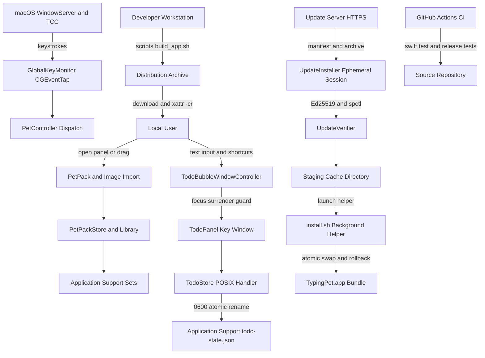

# TypingPetMac — Threat Model

> Repo: `HuihuiDreams/TypingPetMac` (fork of `ynifamily3/TypingPetMac`), branch `main`, baseline v0.19.3 (Build 35).
> Method: repo-grounded AppSec threat model. Every architectural claim is anchored to a repo path/symbol.
> Context Validation: confirmed with maintainer — ad-hoc/unsigned distribution remains supported alongside notarized builds; update feeds are statically hosted with offline maintainer-held Ed25519 keys; Todo persistence is 100% local POSIX storage.

## Executive summary

TypingPetMac is a native macOS desktop companion app (`LSUIElement`, `ing.miel.typingpet`) that combines a borderless floating desktop pet with companion utilities (Todo list, Pomodoro timer) and an in-house auto-updater. The application's defining high-value security asset is that it **holds the macOS "Input Monitoring" (`ListenEvent`) TCC privilege and continuously observes global keystroke events** via `CGEventTap` (`GlobalKeyMonitor.swift:30-72`). Between v0.12.2 and v0.19.3, the system underwent three major architectural expansions: an in-house secure auto-update subsystem (ADR-002), a unified Pet Pack expression engine (ADR-003), and a dual-window companion architecture with interactive text input (ADR-004). 

The primary security risks concentrate in:
1. **Distribution integrity & Gatekeeper bypass on a high-privilege binary (TM-001, TM-002)**: Ad-hoc/unsigned distribution remains an active delivery method requiring users to execute `xattr -cr` to bypass Gatekeeper. Because the app requests surveillance-grade `ListenEvent` TCC permissions, pre-authorization tampering of distributed zips presents high potential impact.
2. **Auto-update supply-chain & staging boundaries (TM-003, TM-004)**: The introduction of network capability (`UpdateInstaller.swift:11-36`) and out-of-process bundle replacement (`UpdateInstaller.swift:114-143`) breaks the historical "zero-network / zero-process" model. This surface is defended by multi-layered cryptographic controls (Ed25519 signatures, SHA-256 hashes, Apple Notarization assessment via `spctl`, and strict Team ID code requirements).
3. **Companion text focus invariants & keystroke isolation (TM-005)**: Adding interactive Todo text input creates potential focus-hijacking hazards where background keystrokes could leak into the pet's fields; this is mitigated by an Aggressive Focus Surrender architecture.
4. **Local file and catalog trust boundaries (TM-006, TM-007, TM-008)**: Pack assets and Todo records are defended by single-level filename sanitization (`StoredFileName.isSafe`), fail-closed regular-file/symlink checks, and hardened Darwin POSIX atomic file descriptors (`O_NOFOLLOW | O_CLOEXEC`, `0600` permissions, 10 MiB limits).

## Scope and assumptions

**In scope (runtime & packaging):**
- Core runtime: `Sources/TypingPet/*` (including `GlobalKeyMonitor`, `PetController`, `TodoBubbleWindowController`, `TodoStore`, `UpdateController`, `UpdateInstaller`, `UpdateManifest`, `PetPacks`, `PetImageLibrary`).
- Hardened Runtime configuration: `Sources/TypingPet/Resources/TypingPet.entitlements`.
- Release, update, and build tooling: `scripts/build_app.sh`, `scripts/notarize_release.sh`, `scripts/publish_update.sh`, `scripts/update_keys.swift`, `scripts/release.py`, `scripts/test_release.py`, `version.json`.
- CI quality gates: `.github/workflows/ci.yml`.

**Out of scope:**
- Unit test suites: `Tests/TypingPetTests/*`.
- Default bundled static artwork: `Sources/TypingPet/Resources/*.png`, `AppIcon.icns`.
- macOS system frameworks: `AppKit`, `CoreGraphics`, `QuartzCore`, `CryptoKit`, `ServiceManagement`.

**Assumptions (validated with maintainer):**
- *Distribution channels:* Distributed as standalone `.zip` archives directly to end users. Both Apple Developer ID signed/notarized releases and ad-hoc unsigned (`-`) builds remain supported distribution targets. (Mac App Store is not a target because global session `CGEventTap` keystroke monitoring is fundamentally prohibited by App Store App Sandbox rules).
- *Update infrastructure:* Update feeds (`https://pet.miel.ing/update/production/latest.json`) are hosted on static CDN / object storage. The Ed25519 update signing private key resides exclusively on the maintainer's local secure environment (`~/.config/typingpet/update-keys/`) and is never committed to git or exposed to CI runners.
- *Network boundary:* Network I/O is strictly quarantined to `UpdateInstaller` using ephemeral uncredentialed `URLSession` sessions solely for checking update feeds and downloading release packages. The core desktop pet, keystroke monitor, and Todo subsystem remain 100% offline with zero network capabilities, telemetry, or analytics.
- *Data sensitivity:* Global keystroke metadata (physical keycode + modifier flags) is considered highly sensitive surveillance-grade data; user Todo tasks are private personal data persisted strictly locally (`0600` POSIX permissions) with no cloud sync or remote export.
- *Host execution model:* Single-user macOS desktop (macOS 13+); no multi-tenancy, no setuid/root helpers, no background daemons or XPC services.

**Open questions:**
- *Distribution transition:* Whether ad-hoc releases will eventually be fully deprecated in favor of Developer ID signed releases once distribution infrastructure matures, allowing complete removal of `xattr -cr` guidance from documentation.

## System model

### Primary components

- **`main.swift` & `AppEnvironment.swift`**: `@MainActor` bootstrap entrypoint. Resolves runtime profile (`production` vs `development`), isolates dev state to distinct bundle ID (`ing.miel.typingpet.dev`) and directory (`TypingPetDev`), enforces single-instance mutual exclusion via `flock` on `.runtime.lock` (`DevelopmentRunLock`), and sets `.accessory` activation policy (`main.swift:3-26`, `AppEnvironment.swift:5-61`).
- **`AppDelegate.swift`**: Application lifecycle orchestrator. Manages `NSStatusItem` menu tray, `SMAppService.mainApp` launch-at-login registration, TCC authorization checks, and update lifecycle termination hooks (`AppDelegate.swift:36-70, 240-260`).
- **`GlobalKeyMonitor.swift`**: Low-level event tap engine. Instantiates session `CGEventTap` (`.listenOnly`) for `keyDown` events, decodes physical key codes and modifier flags into `KeyStroke` structures, and manages MachPort invalidation/reconnection (`GlobalKeyMonitor.swift:30-72`).
- **`PetController.swift` & `PetViews.swift`**: Main floating overlay subsystem. Renders borderless, non-activating floating panel (`PetPanel`, `canBecomeKey = false`, `canBecomeMain = false`), runs pointer avoidance and spring physics, applies energy guards (`abs(opacity - target) > 0.001`), and routes keystroke events to active pet packs (`PetController.swift:203-240`, `PetViews.swift:10-35`).
- **`PetPacks.swift`, `PackEditorModel.swift`, `NativeSetWorkspace.swift`**: Unified Pet Pack engine (ADR-003). Manages `PetPackConfiguration`, multi-frame sequential/random playback modes, channel-isolated playback cursors (`PresetPlaybackCursor`), and preset asset bindings with copy-on-edit protection for built-in packs (`PetPacks.swift:22-120, 280-340`).
- **`PetImageLibrary.swift` & `KeyReactions.swift`**: Image asset disk storage adapter. Manages user image files under `~/Library/Application Support/TypingPet/Sets/<UUID>/`, enforces path traversal defense (`StoredFileName.isSafe`), validates files fail-closed against symlinks, and maintains an `NSCache` memory cache for thumbnails (`PetImageLibrary.swift:5-9, 149-157, 316-329`).
- **`TodoBubbleWindowController.swift` & `TodoBubbleView.swift`**: Dual-window companion subsystem (ADR-004). Coordinates secondary floating speech bubble panel (`TodoPanel`, `canBecomeKey = true`, `canBecomeMain = false`) anchored dynamically to `PetPanel`, implementing Aggressive Focus Surrender on outside clicks, blur, screen lock, or sleep (`TodoBubbleWindowController.swift:5-17, 126-170, 200-225`).
- **`TodoStore.swift`, `TodoState.swift`, `FocusTimerEngine.swift`**: Companion state and persistence layer. Implements Pomodoro focus timer state machine and hardened Darwin POSIX atomic persistence for `todo-state.json` with strict schema validation (`TodoStore.swift:25-86`, `TodoState.swift:118-156`).
- **`TextEditingShortcuts.swift`**: AppKit shortcut dispatcher. Intercepts standard editing shortcuts (`⌘X`, `⌘C`, `⌘V`, `⌘A`, `⌘Z`) for the non-activating accessory application and routes them directly to active text fields (`TextEditingShortcuts.swift:10-40`).
- **`UpdateController.swift`, `UpdateManifest.swift`, `UpdateInstaller.swift`**: In-house cryptographic auto-update subsystem (ADR-002). Fetches release manifests over HTTPS via ephemeral `URLSession`, verifies Ed25519 signatures and SHA-256 digests, checks Apple Notarization (`spctl`) and Developer ID Team ID, and launches an out-of-process `/bin/zsh` helper script for atomic bundle replacement with rollback (`UpdateController.swift:23-50`, `UpdateManifest.swift:41-102, 118-166`, `UpdateInstaller.swift:11-36, 82-143`).
- **`InputMonitoringGuide.swift` & `InputMonitoringGuideModel.swift`**: TCC onboarding assistant. Guides users to macOS System Settings and inspects on-screen window list bounds via `CGWindowListCopyWindowInfo` (inspecting only bundle IDs and window geometry) to dock alongside System Settings (`InputMonitoringGuide.swift:86-114`).
- **`SettingsWindow.swift`, `SettingsWorkspace.swift`, `SettingsNavigation.swift`**: Native settings interface. Tabbed AppKit/SwiftUI workspace with toolbar navigation, language switcher, appearance overrides, and update preferences (`SettingsWindow.swift:147-217`).

### Data flows and trust boundaries

- **macOS WindowServer/TCC → GlobalKeyMonitor**:
  - *Data types:* Raw low-level `CGEvent` keyboard events → `KeyStroke(keyCode, modifiers)`.
  - *Channel:* macOS session event tap (`CGEventTapCreate`, `.listenOnly`).
  - *Guarantees & Validation:* OS-enforced TCC `ListenEvent` gate checked via `CGPreflightListenEventAccess()` and `CGRequestListenEventAccess()` (`AppDelegate.swift:240-252`). Pass-through via `passUnretained` ensures events are never consumed, delayed, or altered. Only physical `keyCode` and modifier bitmasks are read; text characters and IME composition buffers are never read or stored (`GlobalKeyMonitor.swift:44-46`).
- **User Filesystem → App: Pet Pack & Image Import**:
  - *Data types:* User-selected folders or image files (PNG, JPEG, GIF, TIFF, WebP).
  - *Channel:* `NSOpenPanel` or drag-and-drop into `NativeSetWorkspace`.
  - *Guarantees & Validation:* Fail-closed regular file validation (`isSymbolicLink == false && isRegularFile == true`), file extension allow-list, `NSImage` initialization check prior to filesystem copy (`PetImageLibrary.swift:149-157, 336-354`). Copied into isolated unique storage directories (`Sets/<UUID>/`); failed operations trigger complete filesystem rollback.
- **User → TodoPanel: Interactive Task Input & Shortcuts**:
  - *Data types:* Plaintext task titles, Pomodoro duration configurations.
  - *Channel:* AppKit `TodoPanel` (`canBecomeKey = true`), SwiftUI `TextField`, `TextEditingShortcuts`.
  - *Guarantees & Validation:* Aggressive Focus Surrender: global mouse monitor (`leftMouseDown`, `rightMouseDown`), `didResignKeyNotification`, `NSWorkspace.willSleepNotification`, and `com.apple.screenIsLocked` immediately invoke `panel.makeFirstResponder(nil)` (`TodoBubbleWindowController.swift:126-170`). Input lengths are strictly capped by `TodoTitlePolicy.maxLength = 120` and sanitized of linebreaks.
- **App ↔ Application Support: Todo Atomic Persistence**:
  - *Data types:* Serialized JSON state (`todo-state.json`).
  - *Channel:* Darwin POSIX file operations via `TodoFileStorage`.
  - *Guarantees & Validation:* File descriptor opened with `O_RDONLY | O_NOFOLLOW | O_NONBLOCK | O_CLOEXEC` (`TodoStore.swift:27`); mode verified as `S_IFREG`; strict 10 MiB file size ceiling enforced during chunked read (`TodoStore.swift:39-47`). Atomic persistence writes to exclusive temporary file via `mkstemp`, sets user-only permissions (`0600`) via `Darwin.fchmod`, synchronizes buffers via `handle.synchronize()`, and performs atomic swap via `Darwin.rename` (`TodoStore.swift:63-85`). In-memory data strictly validated via `TodoState.validate()`.
- **App ↔ Application Support: Pack Configurations & Asset Storage**:
  - *Data types:* JSON configuration (`packs.json`), image files.
  - *Channel:* `FileManager`.
  - *Guarantees & Validation:* All asset filenames validated via `StoredFileName.isSafe` (rejects empty names, `.`, `..`, and any path containing `/`) before read or deletion (`PetImageLibrary.swift:5-9, 316-329`). File deletion strictly scoped to managed application subdirectories (`Sets/<UUID>/`), never touching user source locations.
- **Remote Update Server (CDN) → UpdateInstaller**:
  - *Data types:* JSON update manifest (`latest.json`), ZIP distribution archive (`TypingPet-*.zip`).
  - *Channel:* Ephemeral `URLSession` (no cache, no cookies, no credentials).
  - *Guarantees & Validation:* Transport security: HTTPS strictly enforced for production (`UpdateManifest.swift:87-91`). Cryptographic validation via `UpdateVerifier`:
    1. Byte size exact match: `data.count == manifest.size`.
    2. Digest match: SHA-256 hash digest matching `manifest.sha256`.
    3. Digital signature: Ed25519 signature validation (`CryptoKit.Curve25519.Signing.PublicKey`) using public key embedded in code-signed `Info.plist` (`TypingPetUpdatePublicKey`).
    4. Bundle identity check: `CFBundleIdentifier` matches running bundle, build channel matches (`production`), build number is strictly monotonic (`build > currentBuild`).
    5. Apple Code Requirement: Evaluates `SecStaticCodeCheckValidity` enforcing Developer ID Team ID match when configured (`UpdateManifest.swift:95-100, 148-165`).
    6. Apple Notarization: Evaluates `/usr/sbin/spctl --assess --type execute` on extracted `.app` bundle for production releases (`UpdateInstaller.swift:60-62`).
- **App → Subprocesses (Update Extraction & Atomic Bundle Replacement)**:
  - *Data types:* Extracted application bundle, process PID, file paths.
  - *Channel:* Subprocess execution via `Process` (`/usr/bin/ditto`, `/usr/sbin/spctl`, `/bin/zsh`).
  - *Guarantees & Validation:* Staging isolated under `~/Library/Caches/<bundle-id>/Updates/<build>-<uuid>/`. Independent `/bin/zsh` helper script executes detached from main application: polls `kill -0 "$pid"` until main process exits, backs up existing `.app` to `previous.app`, performs atomic swap with staged `.app`, clears quarantine (`xattr -dr com.apple.quarantine`), and automatically rolls back if replacement fails (`UpdateInstaller.swift:114-143`).
- **Developer Workstation / CI → End User Distribution**:
  - *Data types:* Standalone `.zip` packages, update feed manifests.
  - *Channel:* Direct download from GitHub Releases/website, or in-app auto-update.
  - *Guarantees & Validation:* Signed with Developer ID Application certificate and notarized via `notarize_release.sh` when available; fallback to ad-hoc (`-`) with Hardened Runtime entitlements (`TypingPet.entitlements`), `-D TYPINGPET_DISTRIBUTION`, `xcrun strip -S`, and SHA-256 release checksum output (`build_app.sh:48-60, 98-122`). Release pipeline (`scripts/release.py:50-71, 125-140`) enforces automated binary-level inspection (`inspect_archive`) rejecting any `/Users/<name>/` build paths, private key files, or credential patterns (`SECRET_PATTERNS`), verified in CI by `scripts/test_release.py:140-150`.

#### Diagram

## Assets and security objectives

| Asset | Why it matters | Security objective (C/I/A) |
| --- | --- | --- |
| System-wide keystroke stream | Observed via `CGEventTap`; unauthorized leakage constitutes keylogger-grade surveillance | Confidentiality |
| Input Monitoring (`ListenEvent`) TCC entitlement | Grants global keystroke tap; exploitation grants persistent, unprompted surveillance foothold | Integrity / Confidentiality |
| Login item (`SMAppService.mainApp`) | Automatically restarts the application and event tap upon user login | Integrity |
| Auto-update Ed25519 signing keypair | Private key signs release manifests; public key in `Info.plist` authorizes executable replacement | Integrity |
| Update delivery channel & staged bundle | Compromise allows delivery of malicious binary replacement to existing installations | Integrity / Availability |
| Companion Todo task records (`todo-state.json`) | Contains private user task titles and timer history; corruption or unauthorized read causes data breach/loss | Confidentiality / Integrity |
| User-imported image sets & packs | User personal art assets; unauthorized deletion or traversal causes user data loss | Integrity / Availability |
| Preferences catalog (`UserDefaults` & `packs.json`) | Controls file paths, active pack selections, and update configurations | Integrity |
| Release binary & code signature | Determines authenticity and trustworthiness of code executed by end users | Integrity |

## Attacker model

### Capabilities

- **Untrusted distribution intermediary / mirror host:** Can modify distributed `.zip` archives on unverified download mirrors or supply-chain channels, enticing users to install modified binaries.
- **Local same-user malware / untrusted process:** Has read/write access to user directories (`~/Library/Preferences/`, `~/Library/Application Support/TypingPet/`, `~/Library/Caches/`), can create malicious symlinks, modify preferences plists, or attempt to alter staged update binaries before replacement. On ad-hoc builds (`-`), same-user processes could exploit the absence of Team ID Library Validation to attempt dylib injection.
- **Malicious file author:** Can supply crafted image files, directory-traversal filenames, deep directory structures, or symlinked files via folder imports or drag-and-drop into the pet pack workspace.
- **Network adversary (Update Channel):** Can monitor or attempt Man-in-the-Middle (MitM) attacks against network connections to `pet.miel.ing`, attempt DNS poisoning, or attempt to host spoofed update feeds.

### Non-capabilities

- **No remote access to core desktop pet:** Core interaction, keystroke tap, physics, and Todo companion contain zero network listener, socket, or RPC code. Remote network attackers have no route to interact with core components.
- **No update signature forgery:** Without the maintainer's offline Ed25519 private key, network adversaries cannot forge valid signatures accepted by `UpdateVerifier`, even if they compromise DNS or CDN content.
- **No privilege escalation beyond standard user:** The application runs strictly as a non-root standard user process (`LSUIElement`), contains no setuid binaries, and communicates with no privileged system helper tools.
- **No capture of text content or IME state:** `GlobalKeyMonitor` reads solely physical keycodes and modifier bitmasks from the WindowServer event stream; it has no capability to read processed Unicode strings, IME composition text, or clipboard content during global typing.
- **No background focus stealing:** Primary `PetPanel` is strictly non-activating (`canBecomeKey = false`); `TodoPanel` enforces Aggressive Focus Surrender on outside clicks, blur, or screen lock, preventing background capture of external app keystrokes.

## Entry points and attack surfaces

| Surface | How reached | Trust boundary | Notes | Evidence (repo path / symbol) |
| --- | --- | --- | --- | --- |
| Global `keyDown` event tap | macOS WindowServer delivers keystrokes | OS WindowServer/TCC → App | Session tap (`.listenOnly`), pass-through, keycodes + modifiers only | `GlobalKeyMonitor.swift:30-72` |
| Auto-update feed fetch | `UpdateController` scheduled timer / manual trigger | Internet (CDN) → App | HTTPS feed fetch via ephemeral `URLSession`; JSON decode | `UpdateInstaller.swift:25-36` |
| Auto-update archive download | Triggered when newer build is detected | Internet (CDN) → App | Download to `~/Library/Caches/.../update.zip`; Ed25519 & SHA-256 verified | `UpdateInstaller.swift:43-53` |
| Archive extraction & inspection | `UpdateInstaller.stage()` | Untrusted archive → Staging filesystem | Invokes `/usr/bin/ditto -x -k`; inspects single `.app` bundle | `UpdateInstaller.swift:54-68` |
| Background install helper script | Launched on app termination when update ready | App → Background Subprocess | Writes `install.sh`, launches `/bin/zsh`, performs atomic `mv` and rollback | `UpdateInstaller.swift:82-143` |
| Todo text input fields | User clicks floating bubble task field | User keyboard → TodoPanel | Key window status acquired; shortcuts parsed via `TextEditingShortcuts` | `TodoBubbleWindowController.swift:5-17`, `TextEditingShortcuts.swift:10-40` |
| Todo state persistence | App launch, periodic tick, or task edit | Filesystem → TodoStore | POSIX `O_NOFOLLOW | O_NONBLOCK`, `0600` permissions, 10 MiB limit | `TodoStore.swift:25-86` |
| Pet pack folder import | Settings → "添加文件夹" open panel | User filesystem → App | Fail-closed symlink check, extension allow-list, `NSImage` decode check | `PetImageLibrary.swift:149-157`, `PetPacks.swift:302-308` |
| Single preset image drag/drop | Settings → Drag image to key / canvas | User filesystem → App | Same copy and validation path with rollback | `NativeSetWorkspace.swift:180-210`, `PetPacks.swift:320-338` |
| Preferences catalog decode | App startup | `UserDefaults` plists → App | Decodes `packs.json` & preferences; validated with `StoredFileName.isSafe` | `PetPreferences.swift:10-45`, `PetPacks.swift:280-305` |
| On-screen window enumeration | Permission guide layout tracking | App → macOS WindowServer | Reads bundle IDs and frames of System Settings via `CGWindowListCopyWindowInfo` | `InputMonitoringGuide.swift:86-114` |
| Login item registration | Toggle in settings or status menu | App → macOS ServiceManagement | Registers main bundle via `SMAppService.mainApp` | `AppDelegate.swift:155-169` |
| Release build & signing pipeline | Developer executes build/release scripts | Workstation / CI → Artifact | Enforces entitlements, strips symbols, scans binary for home paths/secrets, signs & hashes zip | `scripts/build_app.sh:48-122`, `scripts/release.py:50-71` |

## Top abuse paths

1. **Tampered Ad-hoc Distribution Surveillance (TM-001)**: Attacker hosts or redistributes a modified `TypingPet-macOS.zip` containing an outbound keylogger payload -> User downloads build and encounters Gatekeeper warning -> User follows README instructions to run `xattr -cr` -> App launches, requests Input Monitoring -> User grants TCC access -> Malicious binary establishes persistent surveillance with login item.
2. **Gatekeeper Habituation Abuse (TM-002)**: Instruction to run `xattr -cr` habituates users to bypass macOS Gatekeeper screening without validating cryptographic hashes -> Attackers distribute lookalike archives under the guise of "damaged app" bypass.
3. **Malicious / Compromised Update Feed MitM (TM-003)**: Attacker compromises CDN hosting or executes DNS spoofing on `pet.miel.ing` -> Delivers modified `latest.json` referencing a trojaned update archive -> `UpdateInstaller` downloads archive -> `UpdateVerifier` evaluates Ed25519 signature against public key embedded in code-signed `Info.plist` -> Signature verification fails -> Archive is deterministically deleted from staging cache.
4. **Local Staging TOCTOU Race Condition (TM-004)**: Same-user malware monitors `~/Library/Caches/ing.miel.typingpet/Updates/` -> Detects valid update extraction -> Attempts to modify binary contents inside `extracted/TypingPet.app` before `install.sh` executes -> Mitigated by re-running `UpdateVerifier.verifyApp` (`SecStaticCodeCheckValidity` with `kSecCSStrictValidate`) immediately before launching `install.sh` in `applicationWillTerminate()`; any same-user process already has equivalent write access to the target bundle.
5. **Keystroke Interception via Focus Retention (TM-005)**: User clicks Todo bubble to edit a task title -> User switches to a sensitive application (e.g., terminal, password prompt) -> If Todo window fails to resign key focus, external keystrokes type into the Todo task field -> Mitigated by Aggressive Focus Surrender: global mouse click monitor, `didResignKeyNotification`, and screen lock notifications immediately force `makeFirstResponder(nil)`.
6. **Path Traversal via Catalog Tampering (TM-006)**: Same-user attacker or malicious script edits `packs.json` or `imageGalleryData-v1` injecting `../../` relative paths into `fileName` or `storageFolder` -> App initializes -> Attempted traversal is intercepted and rejected by `StoredFileName.isSafe`, preventing file read or deletion outside application support sandbox.
7. **Symlink Traversal via Folder Import (TM-007)**: Malicious actor crafts a zip folder containing a symlink `normal.png -> ~/.ssh/id_rsa` -> User imports folder into Pet Pack workspace -> App inspects file attributes using `URLResourceKey.isSymbolicLinkKey` and `isRegularFileKey` -> Symlink is detected and rejected fail-closed; import succeeds only for genuine regular files.
8. **Resource Exhaustion via Local Image Import (TM-008)**: User selects a malformed or very large local image file -> `NSImage(contentsOf:)` decodes only user-selected local files -> Mitigated by `NSCache` count limit of 64 (`PetImageLibrary.swift:81`) and explicit cache eviction of previous pack reaction frames upon pack switching (`PetImageLibrary.swift:193-201`).
9. **Development Feed URL Override Hijack (TM-009)**: Same-user attacker modifies development preferences setting `updateFeedURL` to point to a local malicious server -> In Dev mode (`ing.miel.typingpet.dev`), loopback HTTP is permitted -> Attacker serves malicious build -> Blocked because `UpdateVerifier` still enforces Ed25519 signature check against the dev public key.

## Threat model table

| Threat ID | Threat source | Prerequisites | Threat action | Impact | Impacted assets | Existing controls (evidence) | Gaps | Recommended mitigations | Detection ideas | Likelihood | Impact severity | Priority |
| --- | --- | --- | --- | --- | --- | --- | --- | --- | --- | --- | --- | --- |
| TM-001 | Tampered distributed build / malicious mirror | User downloads modified archive from unverified mirror; grants TCC | Inject exfiltration payload into ad-hoc binary; inherit `ListenEvent` TCC grant and login persistence | Full system-wide keystroke surveillance and persistence | Keystroke stream, TCC grant, login item | `.listenOnly` pass-through (`GlobalKeyMonitor.swift:52-61`); zero network in core codebase; `TypingPet.entitlements` specifies Hardened Runtime flags; `build_app.sh` calculates and displays release SHA-256; `spctl` assessment enforced for notarized builds | Ad-hoc releases default to `-` signature where Team-ID Library Validation is inactive and Gatekeeper blocks | Promote Developer ID signed and notarized releases as primary; publish SHA-256 checksums on GitHub Releases; encourage source builds | Monitor for unexpected network sockets in processes named TypingPet; Gatekeeper telemetry | Low | High | Medium |
| TM-002 | Distribution process & documentation | User runs ad-hoc build | End user follows `xattr -cr` guidance without verifying SHA-256 hash | User bypasses OS Gatekeeper screening, facilitating trojan delivery | Release integrity, user trust, TCC grant | `build_app.sh` auto-selects Developer ID when present; `notarize_release.sh` enforces notarization; README provides `shasum -a 256` verification instructions | Users frequently bypass verification and execute `xattr -cr` blindly | Provide one-line terminal verification command before `xattr -cr`; transition to notarized distribution | Audit download logs; warn users in README about hazards of downloading from third-party sites | Medium | High | High |
| TM-003 | Network adversary / compromised CDN | Man-in-the-Middle or control over update CDN | Serve spoofed `latest.json` manifest and tampered update archive | Attempted execution of unauthorized binary update | Application binary, update delivery channel | Ephemeral `URLSession`; HTTPS enforced in production (`UpdateManifest.swift:87-91`); Ed25519 signature verification via `CryptoKit` against embedded public key (`UpdateVerifier.swift:128-135`); SHA-256 digest match; monotonic build number requirement | Update feed uses static CDN without mutual TLS | Enforce Ed25519 key rotation runbook; monitor CDN access logs for unauthorized manifest modifications | Alert on manifest decode failures or invalid Ed25519 signature verification attempts | Very Low | High | Low |
| TM-004 | Local same-user malware | Local malware with user filesystem access | Tamper with staged `.app` bundle in `~/Library/Caches/.../Updates/` before helper moves it | Local privilege persistence / code execution within app context | Executable binary, TCC grant | Isolated staging directory with UUID; `UpdateVerifier.verifyApp` re-checks bundle ID, build channel, and `SecStaticCodeCheckValidity` (`kSecCSStrictValidate`) immediately prior to launching helper (`UpdateController.swift:184-195`); helper restores backup on error | None meaningful across privilege boundaries (a same-user process already has write access to the user-writable target `.app`) | Keep `UpdateVerifier.verifyApp` in `applicationWillTerminate()` immediately before `launchHelper` | File integrity monitoring on `~/Library/Caches/ing.miel.typingpet/Updates/` | Low | Medium | Low |
| TM-005 | Focus retention / UI confusion | User editing Todo tasks while switching apps | Keystrokes intended for external application typed into Todo task input field | Unintended keystroke capture / sensitive data stored in Todo history | User privacy, Todo task records | Aggressive Focus Surrender: global mouse click monitor (`leftMouseDown`, `rightMouseDown`), `NSWindow.didResignKeyNotification`, `NSWorkspace.willSleepNotification`, and `com.apple.screenIsLocked` call `makeFirstResponder(nil)` (`TodoBubbleWindowController.swift:126-170`) | If user clicks directly on Todo text field, it legitimately acquires key focus | Keep visual feedback prominent when Todo bubble is active | Monitor unexpected key event dispatch while app is inactive | Low | Medium | Low |
| TM-006 | Same-user attacker / corrupt catalog | Local write access to `UserDefaults` or `packs.json` | Inject `../` traversal sequences into preset filenames or storage folders | Arbitrary file read or unauthorized file deletion under user directories | User files, application support storage | `StoredFileName.isSafe` validates every file read/delete (rejects `.`, `..`, empty, `/`) (`PetImageLibrary.swift:5-9, 316-329`); regression tests assert rejection (`ImageStorageFailureTests.swift:306-342`) | Guard must be called on every path construction site | Funnel all path construction through centralized safe URL builders; lint against raw `appendingPathComponent` without validation | Unit tests and fuzz testing of catalog deserialization | Low | Medium | Low |
| TM-007 | Malicious file author | User imports crafted folder or pack containing symlinks | Symlink copied to app storage, pointing to sensitive files (e.g. `~/.ssh`) | Information disclosure in app UI or accidental file overwrite | User files, app storage | Fail-closed validation (`isSymbolicLink == false && isRegularFile == true`) in `addSet`, `copyImage`, and `PetPacks` import (`PetImageLibrary.swift:149-157`, `PetPacks.swift:302-308`); `NSImage` decode check before copy | None identified in current import paths | Maintain fail-closed symlink checks across all future import and drag-and-drop paths | Log any encountered symlinks during import operations | Very Low | Low | Low |
| TM-008 | Malicious file author | User imports huge or malformed local image | `NSImage` decode increases memory usage during local import | Transient local memory spike | Application availability | `NSCache` memory cache limits thumbnails to 64 items (`PetImageLibrary.swift:81`); `activateSet` evicts previous set reaction cache (`PetImageLibrary.swift:193-201`); decode failure handled gracefully | None meaningful (images are strictly user-selected local files with no remote/untrusted upload surface; arbitrary pixel caps would reject legitimate 4K/5K artwork) | Keep `NSCache` count limit and active-set cache eviction in place | Track import decode failures | Very Low | Low | Low |
| TM-009 | Same-user attacker / dev misuse | Ability to edit development preferences | Set `updateFeedURL` to point to malicious loopback server | Trigger update check against local mock server | Development binary integrity | Allowed only in development profile (`profile == .development`); restricted to `localhost`, `127.0.0.1`, `::1` (`UpdateManifest.swift:87-91`); Ed25519 signature verification remains mandatory | Dev builds can test updates over unencrypted loopback HTTP | Keep `NSAllowsLocalNetworking` restricted strictly to development builds (`generate_plist.py:28-30`) | Log feed override configuration in development console | Very Low | Low | Low |
| TM-010 | Local same-user malware | Local malware attempting to hijack or corrupt Todo storage | Inject FIFO, symlink, or race `todo-state.json` write | Denial of service or corrupted task state | Todo state persistence | `TodoFileStorage` opens with `O_RDONLY | O_NOFOLLOW | O_NONBLOCK | O_CLOEXEC`; mode verified `S_IFREG`; 10 MiB limit; `0600` permissions; atomic swap via `mkstemp` and `rename` (`TodoStore.swift:25-86`) | None identified; hardened against symlinks and blocking FIFOs | Maintain POSIX descriptor checks; avoid higher-level Cocoa write methods that follow symlinks | Log POSIX errors when opening or renaming state files | Very Low | Low | Low |
| TM-011 | Local process / screen observer | Local process observing window server geometry | Observe `InputMonitoringGuide` enumerating window bounds | Information disclosure regarding open System Settings window | Window geometry metadata | Enumerates only bundle IDs matching Apple System Settings; avoids window names (`kCGWindowName`) and content capture (`CGWindowListCreateImage`) (`InputMonitoringGuide.swift:86-114`) | Window existence and screen bounds of System Settings are visible to the process | None required; keep bundle ID filter minimal and non-invasive | n/a | Low | Very Low | Low |
| TM-012 | Compiler / Packager | Building release binary | Leaking local developer file paths or private keys in release artifacts | Low-sensitivity local filesystem path disclosure or credential leak in release binary | Binary metadata & secret privacy | `#filePath` strictly restricted to `#if DEBUG` (`PetImageLibrary.swift:332-338`); `build_app.sh` compiles production with `-D TYPINGPET_DISTRIBUTION` and strips symbols via `xcrun strip -S` (`build_app.sh:48-60`); `scripts/release.py` (`inspect_archive`, `snapshot`) scans release binary bytes for `/Users/<name>/` paths and private keys/tokens (`scripts/release.py:50-71, 125-140`), tested by `scripts/test_release.py:140-150` | None (enforced at both source compilation and release binary inspection layers) | Keep `inspect_archive` and `test_release.py` active in CI (`.github/workflows/ci.yml:20`) | CI failure on `test_release.py` or `release.py` preflight/archive inspection | Very Low | Very Low | Low |

*Assumption calibration:* The "High" priority assigned to TM-002 reflects the user confirmation that unsigned/ad-hoc packages remain an active distribution channel, where Gatekeeper warnings are bypassed via `xattr -cr`. If official distribution moves exclusively to Apple Developer ID signed and notarized bundles, TM-001 and TM-002 would drop to Low.

## Criticality calibration

- **Critical (for this repo):** Remote, unauthenticated execution of arbitrary code or unauthorized exfiltration of the system-wide keystroke stream. Currently, no such path exists: core keystroke processing is 100% offline, and update downloads require cryptographically valid Ed25519 signatures and Developer ID notarization before execution.
- **High:** Distribution or supply-chain compromise where a tampered binary claiming `ListenEvent` TCC permissions is executed by users (e.g., TM-001, TM-002). Because the app holds persistent keystroke-monitoring capabilities, any pre-authorization binary tampering has high surveillance impact.
- **Medium:** Local, same-user integrity or availability bypasses without privilege escalation — such as race conditions in local update staging (TM-004), accidental focus capture in the companion Todo bubble (TM-005), or potential regressions in the catalog filename traversal guard (TM-006).
- **Low:** Bounded-impact local issues — symlink import attempts (TM-007), local image decode memory usage (TM-008), dev feed overrides (TM-009), POSIX file locking contention (TM-010), window metadata observation (TM-011), or build path leakage (TM-012).

## Focus paths for security review

| Path | Why it matters | Related Threat IDs |
| --- | --- | --- |
| `Sources/TypingPet/GlobalKeyMonitor.swift` | Implements low-level `CGEventTap`; core surveillance-grade capability in the codebase | TM-001 |
| `Sources/TypingPet/UpdateInstaller.swift` | Manages ephemeral network sessions, ditto extraction, spctl notarization, and `install.sh` helper execution | TM-003, TM-004 |
| `Sources/TypingPet/UpdateManifest.swift` | Implements `UpdateVerifier`, Ed25519 signature checks (`CryptoKit`), SHA-256 digests, and code requirements | TM-003 |
| `Sources/TypingPet/UpdateController.swift` | Coordinates update check schedule, download staging, and atomic helper launch on termination | TM-003, TM-004 |
| `Sources/TypingPet/TodoBubbleWindowController.swift` | Enforces Aggressive Focus Surrender invariants to prevent background keystroke leakage into Todo fields | TM-005 |
| `Sources/TypingPet/TodoStore.swift` | Implements hardened Darwin POSIX file operations (`O_NOFOLLOW`, `0600`, `mkstemp`, `rename`) | TM-010 |
| `Sources/TypingPet/TodoState.swift` | Enforces schema validation and string length sanitization (`TodoTitlePolicy.maxLength = 120`) | TM-005, TM-010 |
| `Sources/TypingPet/PetImageLibrary.swift` | Implements `StoredFileName.isSafe`, fail-closed symlink filtering, and `Sets/<UUID>/` directory isolation | TM-006, TM-007, TM-008 |
| `Sources/TypingPet/PetPacks.swift` | Manages unified Pet Pack configuration deserialization, playback cursors, and preset asset paths | TM-006, TM-007 |
| `Sources/TypingPet/Resources/TypingPet.entitlements` | Defines Hardened Runtime security posture (JIT disabled, unsigned memory disabled, library validation active) | TM-001, TM-002 |
| `scripts/build_app.sh` | Controls codesigning, Developer ID identity resolution, `-D TYPINGPET_DISTRIBUTION`, symbol stripping, and packaging | TM-001, TM-002, TM-012 |
| `scripts/release.py` & `scripts/test_release.py` | Enforces binary-level `/Users/<name>/` path rejection, private key/token scanning (`SECRET_PATTERNS`), and release guards | TM-001, TM-003, TM-012 |
| `scripts/publish_update.sh` & `update_keys.swift` | Generates Ed25519 signatures for release archives and checks notarization before publishing feed | TM-003 |
| `README.md`, `README.txt` | Contains `xattr -cr` instructions and integrity verification guidance that directly shape user security behavior | TM-002 |

## Notes on use

- **Shipped provenance verification:** Security reviewers must ensure distributed `.app` bundles correspond directly to verified commits (confirming `CFBundleShortVersionString` and `CFBundleVersion` in `version.json` match release tags).
- **Architectural boundaries preservation:** The application's threat posture relies on two hard isolation boundaries:
  1. The core desktop pet and keystroke monitor remain strictly offline with zero network code.
  2. The auto-update subsystem is strictly constrained to ephemeral HTTPS requests, Ed25519 cryptographic verification, and detached atomic helper replacement.
  Any proposal to introduce analytics, cloud sync, or third-party web frameworks into the core pet runtime would invalidate these assumptions and require a fundamental re-assessment of the threat model.
- **Secrets audit:** Static inspection and `scripts/release.py` (`SECRET_PATTERNS`) confirm zero embedded API tokens, passwords, or private signing keys in `Sources/` or repository scripts. Ed25519 signing keys are loaded strictly from external maintainer configuration paths (`~/.config/typingpet/update-keys/`).
