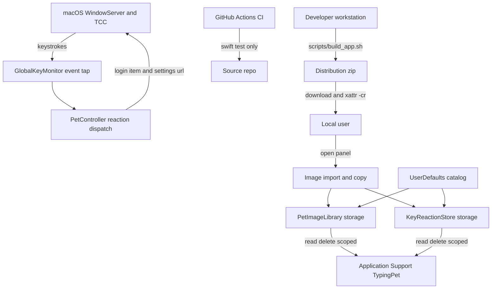

# TypingPetMac — Threat Model

> Repo: `HuihuiDreams/TypingPetMac` (fork of `ynifamily3/TypingPetMac`), branch `main`, baseline v0.12.2.
> Method: repo-grounded AppSec threat model. Every architectural claim is anchored to a repo path/symbol.
> Status: assumptions are stated inline; see **Scope and assumptions** and **Open questions**.

## Executive summary

TypingPetMac is an offline, single-process macOS menu-bar app (`LSUIElement`, `ing.miel.typingpet`) whose defining security-relevant property is that it **holds macOS "Input Monitoring" (`ListenEvent`) TCC access and passively monitors every keystroke system-wide** through a `CGEventTap` (`GlobalKeyMonitor.swift:52-61`). There is **no network code, no subprocess execution, no eval, and no credential storage** in the app (confirmed by search: no `URLSession`, `Process`, `NSTask`, `NSAppleScript`, keys/tokens). That removes the entire remote attack class (RCE-over-HTTP, SSRF, injection, MITM) — the architecture doc/section 8 matches the code.

The residual risk therefore concentrates in two places, not in the app's parser surface:

1. **Distribution integrity vs. a high-value permission.** The app requires a TCC grant that is a surveillance-grade foothold, yet releases are unsigned or ad-hoc signed by default and the user-facing docs instruct users to defeat Gatekeeper with `xattr -cr` while asserting the app is "绝对安全" (absolutely safe). A tampered or malicious build that users run this way inherits a persistent, launch-at-login, system-wide keystroke monitor.
2. **Local file/preference trust boundaries** (user-picked folders and the `UserDefaults` catalog). These are already well-defended by a single-level filename guard (`StoredFileName.isSafe`) with regression tests, so this surface is **low** residual risk — but it is where a reviewer should confirm the guard is not bypassable.

## Scope and assumptions

**In scope (runtime):** `Sources/TypingPet/*`, the packaging scripts (`scripts/build_app.sh`, `scripts/notarize_release.sh`), and the CI workflow (`.github/workflows/ci.yml`).

**Out of scope:** Tests (`Tests/TypingPetTests/*`), default bundled art assets, and Apple system frameworks (`CoreGraphics`, `AppKit`, `ServiceManagement`) themselves.

**Assumptions (correct these if wrong — they move the ranking):**
- *Deployment:* distributed directly to end users as a zipped `.app` (README download/install flow), not through the Mac App Store. (Note: Mac App Store App Sandbox rules fundamentally prohibit global session `CGEventTap` keystroke monitoring across arbitrary third-party applications; see **Open questions**).
- *Exposure:* no network listener; the app cannot be reached remotely. Only local, same-host attackers and file/preference inputs matter.
- *Data sensitivity:* keystroke **metadata** (physical keycode + modifier flags) is treated as sensitive; the app claims it stores/transmits nothing (`README.md:90-93`, `AppDelegate.swift:244`).
- *Single user, single machine;* no multi-tenancy, no server component.
- *Trust in the source repo itself* is assumed for the analysis of the shipped app; the fork/upstream relationship is treated as a supply-chain boundary.

**Open questions that would materially change ranking:** see **Open questions** at the end of this document.

## System model

### Primary components
- `main.swift` — `@MainActor` bootstrap, sets `.accessory` activation policy (`main.swift:5-10`).
- `AppDelegate.swift` — lifecycle, `NSStatusItem` menu, `SMAppService` login item, TCC permission coordination (`AppDelegate.swift:29-62`, `155-169`, `231-252`).
- `GlobalKeyMonitor.swift` — `CGEventTap` `.listenOnly` on `keyDown`, maps to `KeyStroke` (`GlobalKeyMonitor.swift:30-72`).
- `PetController.swift` — floating non-activating panel, physics/pointer-evasion, keystroke→image reaction dispatch (`PetController.swift:203-222`).
- `PetImageLibrary.swift` — custom image sets, disk store under Application Support, filename safety guard (`PetImageLibrary.swift:5-9`, `245-334`).
- `KeyReactions.swift` — per-keystroke image rules + disk store (`KeyReactions.swift:84-151`).
- `SettingsWindow.swift` — SwiftUI settings, `NSOpenPanel` imports, key recorder (`SettingsWindow.swift:147-217`, `557-627`).
- `InputMonitoringGuide.swift` — permission onboarding panel; enumerates on-screen windows via `CGWindowListCopyWindowInfo` to follow System Settings (`InputMonitoringGuide.swift:86-114`).

### Data flows and trust boundaries

- **macOS WindowServer/TCC → GlobalKeyMonitor.** Types: raw `CGEvent` keystrokes → `KeyStroke(keyCode, modifiers)`. Channel: session event tap (`.listenOnly`). Guarantees: OS-enforced TCC `ListenEvent` gate via `CGPreflightListenEventAccess()` / `CGRequestListenEventAccess()` (`GlobalKeyMonitor.swift:26-28`, `AppDelegate.swift:232-241`); pass-through (`passUnretained`) so no event is consumed/modified. Validation: only `keyDown` is read; character/IME data is **not** captured (`GlobalKeyMonitor.swift:44-46`).
- **User → App: folder import.** Types: user-selected folder of image files. Channel: `NSOpenPanel` → `PetImageLibrary.addSet` → `copyItem` into `Sets/<UUID>/`. Guarantees: user-driven via standard open panel; regular-file + non-symlink filter (`isSymbolicLink == false && isRegularFile == true`), extension allow-list, and `NSImage` read check before copy (`PetImageLibrary.swift:149-157`, `336-354`); rollback on failure (`180-183`). No schema/magic-byte validation beyond extension + `NSImage` decode.
- **User → App: single image for key rule.** Channel: `NSOpenPanel` (`allowedContentTypes = [.image]`) → `KeyReactionStore.setRule` → `copyItem` into `KeyReactions/` (`SettingsWindow.swift:557-566`, `KeyReactions.swift:95-126`).
- **UserDefaults → App (catalog).** Types: JSON `[PetImageSet]` / `[KeyReactionRule]`. Channel: local preferences plist decoded on init (`PetImageLibrary.swift:92-97`, `KeyReactions.swift:76-81`). Guarantees: filenames validated on use by `StoredFileName.isSafe` (rejects empty, `.`, `..`, any name containing `/`) before any read/delete (`PetImageLibrary.swift:5-9`, `251`, `316-329`; `KeyReactions.swift:89`, `139-147`).
- **App ↔ Application Support filesystem.** Types: stored image copies. Channel: `FileManager`. Guarantees: all paths derived from validated single-level names; deletion scoped to `Sets/<UUID>/` or legacy `Images/` single files, never user source dirs (`PetImageLibrary.swift:313-334`).
- **App → macOS services.** Login item via `SMAppService.mainApp.register()` (`AppDelegate.swift:155-161`); opens `x-apple.systempreferences:...Privacy_ListenEvent` (`InputMonitoringGuide.swift:29-36`); reads system window list (`InputMonitoringGuide.swift:92-95`).
- **Release pipeline → end user.** Channel: developer runs `build_app.sh` locally (build → bundle → `Info.plist` → codesign) producing `dist/TypingPet-macOS.zip`; `notarize_release.sh` (Developer ID + notarytool + staple). (Note: CI in `.github/workflows/ci.yml` is limited to automated `swift test` and does not package or publish release bundles). Guarantees: Developer ID path when a cert exists; **falls back to ad-hoc `-`** otherwise (`build_app.sh:63-90`). User docs instruct `xattr -cr` to clear quarantine (`README.md:33-38`).

#### Diagram

## Assets and security objectives

| Asset | Why it matters | Security objective (C/I/A) |
| --- | --- | --- |
| System-wide keystroke metadata stream | Captured via `CGEventTap`; leak = keylogger-class impact | Confidentiality |
| Input Monitoring (`ListenEvent`) TCC grant on app identity | Enables the keystroke tap; abused = persistent surveillance foothold | Integrity / Confidentiality |
| Login-item registration (`SMAppService`) | Auto-runs the tap at every login | Integrity |
| User-imported image sets (and source folders they came from) | User's personal files; deletion/read would be data loss | Integrity / Confidentiality |
| Stored copies under `Application Support/TypingPet/` | App-managed data; correctness of cleanup matters | Integrity / Availability |
| `UserDefaults` catalog (gallery + rules JSON) | Drives file paths used for read/delete | Integrity |
| Release binary, signing identity, notarization ticket | Determines what code users trust and run | Integrity |
| Login/asset/pipeline origin (upstream repo, CI action) | Supply-chain trust anchor | Integrity |

## Attacker model

### Capabilities
- **Local same-user malware / malicious app**: can read and write the user's `~/Library/Preferences/ing.miel.typingpet.plist` and `Application Support/TypingPet/`, and can pass crafted image folders through the app's own UI. (Note: a same-user attacker able to write UserDefaults already has same-user code execution, which bounds the *incremental* impact of preference tampering. However, on ad-hoc signed builds (`-`), the binary lacks Apple Library Validation, which theoretically leaves it susceptible to local dylib injection via `DYLD_INSERT_LIBRARIES` by same-user malware seeking to piggyback on the active `ListenEvent` TCC grant without triggering a new OS permission prompt.)
- **Malicious file author**: can supply an image file (or folder of images) a user imports, including malformed or "decompression-bomb" images and symlinks.
- **Supply-chain actor**: controls or tampers with a distributed artifact (e.g., a re-uploaded zip on the download path, or a fork/PR in the repo), and can influence `build_app.sh` when it runs.
- **Distribution intermediary / re-packager**: can modify the unsigned zip between build and download.

### Non-capabilities (unless assumptions change)
- **No remote/network attacker**: no sockets, no `URLSession`, no server — nothing to connect to (`README.md:90-93`; no matches for network APIs in `Sources/`).
- **No pre-auth or privilege-escalation path in-app**: single-process, no setuid, no helper, no XPC, runs as the user; cannot escalate beyond the user or read other users' data.
- **No keystroke *content* capture**: only physical keycode + modifier flags are read; text/IME composition is not accessed (`GlobalKeyMonitor.swift:44-46`; `SettingsWindow.swift:426`).
- **No code-injection surface**: no `eval`, no shell, no dynamic code, no deserialization of non-JSON untrusted formats.
- **Signed/notarized path** removes forgery risk for that release channel (but is not the default).

## Entry points and attack surfaces

| Surface | How reached | Trust boundary | Notes | Evidence |
| --- | --- | --- | --- | --- |
| Global `keyDown` event tap | OS delivers all keystrokes | WindowServer/TCC → app | `.listenOnly`, pass-through, keycode+modifiers only | `GlobalKeyMonitor.swift:30-61` |
| Folder image import | Settings → "添加文件夹" `NSOpenPanel` | User file → app | Extension allow-list + `NSImage` decode; copy into `Sets/<UUID>/` | `SettingsWindow.swift:147-161`, `PetImageLibrary.swift:149-195`, `333-347` |
| Single image for key rule | Settings → "添加规则" `NSOpenPanel` | User file → app | `.image` only; copied into `KeyReactions/` | `SettingsWindow.swift:557-566`, `KeyReactions.swift:95-122` |
| Image replacement (idle/reactions) | Settings / controller | User file → app | Same copy path with rollback | `PetImageLibrary.swift:220-227`, `270-308` |
| Preferences catalog decode | App launch | UserDefaults → app | JSON; filenames guarded on use | `PetImageLibrary.swift:92-97`, `KeyReactions.swift:76-81` |
| CLI flag `--show-settings` | App launch args | local caller → app | Only opens the settings window | `AppDelegate.swift:59-61` |
| On-screen window enumeration | Guide `show()` timers | app → OS | Reads owner PID + bounds for System Settings bundle ids only | `InputMonitoringGuide.swift:86-114` |
| Login-item registration | Menu/settings toggle | app → OS | `SMAppService.mainApp` | `AppDelegate.swift:155-169`, `SettingsWindow.swift:128-136` |
| Settings deep-link open | Guide/menu button | app → OS | Fixed `x-apple.systempreferences:` URL | `InputMonitoringGuide.swift:29-36` |
| Release build/sign | Developer/CI runs script | dev/CI → artifact | Auto-selects identity or ad-hoc `-` | `build_app.sh:63-84` |
| CI pipeline | Push/PR to `main` | repo → CI | `actions/checkout@v5`, `swift test` | `.github/workflows/ci.yml:9-16` |

## Top abuse paths

1. **Tampered-build surveillance.** Attacker re-packages/modifies the unsigned `TypingPet-macOS.zip` → user follows README and runs `xattr -cr` to bypass Gatekeeper → malicious build asks for (or already has) Input Monitoring → system-wide keystroke tap exfiltrates via the attacker's added code. (Note: on ad-hoc builds, macOS binds the TCC entry to the binary's `cdhash`; modifying an already-authorized binary invalidates the grant, so the primary risk is pre-authorization distribution tampering where a user grants TCC to an already-trojaned binary). Impact: full keystroke monitoring, persistent.
2. **Supply-chain persistence.** A malicious contributor/PR or compromised CI produces a build → since releases default to ad-hoc signing and trust is placed in the repo/download page → users run it with the app's TCC identity and login item, dodging signature-based detection.
3. **Preference-catalog path abuse (mitigated).** Same-user attacker edits `imageGalleryData-v1` / `keyReactionRules-v1` with `../../` names → if unguarded, app would read/delete outside storage. Current guard rejects these and tests assert it.
4. **Symlink folder import.** User imports a folder containing a symlinked `*.png` pointing at a sensitive file → app copies the link and decodes it, surfacing content inside the pet (and the link persists in `Sets/<UUID>/`).
5. **Decode resource exhaustion.** User imports a huge or "image bomb" file → `NSImage(contentsOf:)` expansion spikes memory/CPU. Local, user-triggered DoS.
6. **Guide window probing.** A local process observes that the guide panel enumerates window bounds to align beside System Settings — no sensitive data is read, but it confirms a global window-list reader exists.

## Threat model table

| ID | Threat source | Prerequisites | Threat action | Impact | Impacted assets | Existing controls (evidence) | Gaps | Recommended mitigations | Detection ideas | Likelihood | Impact severity | Priority |
| --- | --- | --- | --- | --- | --- | --- | --- | --- | --- | --- | --- | --- | --- |
| TM-001 | Tampered distributed build / local malware | User downloads and runs a modified build; grants Input Monitoring | Ship a build that adds keystroke exfil on top of the legitimate tap; inherit login item + TCC grant | Full system-wide keystroke surveillance, persistence | Keystroke stream, TCC grant, login item | `.listenOnly` pass-through (`GlobalKeyMonitor.swift:52-61`); zero network in shipped code; ad-hoc TCC binds to binary `cdhash`; `TypingPet.entitlements` locks down Hardened Runtime (`disable-library-validation = false`, enforced when signed with a Team ID certificate); `build_app.sh` requires entitlements and outputs `shasum -a 256` for release verification | Releases default to ad-hoc signing when Developer ID is absent (where Team-ID library validation is inactive and Gatekeeper intercepts) | Developer ID-sign + notarize releases when cert available (`notarize_release.sh`); publish SHA-256 with releases for user verification; provide source build option | Watch for `CGEventTap` keyDown + outbound-socket combination in any "TypingPet" binary; Gatekeeper/`notarization` telemetry | Low | High | Medium |
| TM-002 | Distribution process | None (misconfiguration) | Ad-hoc signed artifact presented to users as safe, with instructions to strip quarantine | Users bypass OS malware screening without verifying integrity | Release integrity, user trust, TCC grant | `build_app.sh` prefers Developer ID when present (`build_app.sh:78-90`); `notarize_release.sh` enforces Developer ID; README/README.txt instruct SHA-256 hash check before `xattr -cr`; tempered claims to verifiable offline properties | Gatekeeper warnings remain on ad-hoc builds until Developer ID cert is acquired | Make notarized build when Developer ID is available; enforce SHA-256 release checklist | CI gate that fails release without a Developer ID cert; alert if a published zip lacks a stapled ticket | Low | High | Medium |
| TM-003 | Same-user local attacker / corrupted catalog | Ability to edit `UserDefaults` or on-disk JSON | Inject `../` filenames or `storageFolder` values to redirect reads/deletes outside storage | Arbitrary file read or file/dir deletion | Stored copies, user files | `StoredFileName.isSafe` gate on every resolve/delete (`PetImageLibrary.swift:5-9`, `251`, `316-329`; `KeyReactions.swift:89`, `139-147`); tests assert rejection (`ImageStorageFailureTests.swift:306-342`) | Guard is the only defense; any future path-building that skips it reintroduces traversal | Keep all path construction funneled through the guard; add a lint/test that fails if `appendingPathComponent` is called with an unvalidated catalog name | Unit assertion already exists; add fuzz test enumerating catalog names | Low | Medium | Low |
| TM-004 | Malicious file author | User imports a folder containing a symlink | Symlinked `*.png` copied into store; decoded content surfaced; link persists | Limited info disclosure inside the app; stray link on disk | User files, storage | Extension allow-list + `NSImage` decode before copy (`PetImageLibrary.swift:336-354`); `skipsHiddenFiles` on listing; `addSet`, `copyImage`, and `setRule` enforce fail-closed `isSymbolicLink == false && isRegularFile == true`; `NSImage` fails on non-image targets | None (mitigated by fail-closed regular-file and non-symlink check + regression tests) | Keep symlink filtering active in file import paths | Log/alert on symlink encountered during import | Very Low | Low | Low |
| TM-005 | Malicious file author | User imports a crafted/bomb image | `NSImage(contentsOf:)`/decode exhausts memory/CPU | Local availability hit, possible freeze | App availability | `NSCache` count limit 64 (`PetImageLibrary.swift:81`); decode failure handled as error | No size/pixel-dimension cap before decode | Check file size and/or pixel dimensions before `NSImage` decode; cap imported count | Track import failures; alert on repeated decode timeouts | Low | Low | Low |
| TM-006 | Supply-chain actor | Influence over repo/CI or the developer's keychain | Taint build inputs; or `build_app.sh` auto-selects an unintended signing identity | Release integrity compromise; wrong cert used | Release binary, signing identity | Script prefers explicit `CODE_SIGN_IDENTITY`, else searches keychain (`build_app.sh:63-77`) | Auto-discovery can pick an unexpected cert; CI action not pinned by SHA | Require explicit identity in CI; pin third-party actions to commit SHAs; protect `main` and require review | Build provenance logs; `codesign -dv` recorded per release; alert on identity change between releases | Low | High | Medium |
| TM-007 | Local attacker (weak capability) | Local process, screen access | Observe guide panel enumerating window list / aligning beside System Settings | No sensitive data read; exposes a global window reader | Screen/geometry metadata | Reads only System Settings PIDs + bounds (`InputMonitoringGuide.swift:86-114`); avoids window title (`kCGWindowName`) and content capture (`CGWindowListCreateImage`), avoiding triggering Screen Recording (`kTCCServiceScreenCapture`) TCC prompts | None meaningful | None required; keep bundle-id filter minimal | n/a | Low | Low | Low |
| TM-008 | Researcher / packager | Runs release build | `#filePath` embeds local machine path in binary | Low-sensitivity path disclosure | Release binary metadata | `#filePath` only inside `#if DEBUG` (`PetImageLibrary.swift:264-270`) | None (guard verified; sole occurrence) | Keep the `#if DEBUG` rule enforced in review/CI grep | CI grep failing on `#filePath` outside `#if DEBUG` | Very Low | Very Low | Low |

*Assumption note:* the ranking of TM-001/TM-002 depends heavily on the distribution assumption above (direct download, unsigned default). If releases are always notarized and served from a signature-verifiable channel, both drop to **Medium/Low** and the parser-boundary items become the top relative risks. Note that Mac App Store sandboxing is not a viable alternative mitigation because `CGEventTap` session monitoring is prohibited within the App Sandbox.

## Criticality calibration

- **Critical (for this repo):** a remote, unauthenticated path to code execution or to the keystroke stream — *currently none exists* (no network, no dynamic code). If one were found, it would be critical because the app already holds a system-wide input tap.
- **High:** compromise of the *distributed binary* or its trust story such that a keystroke-monitoring app can be tampered and still run with TCC/login persistence (TM-001, TM-002). Impact is surveillance-grade; likelihood is channel-dependent.
- **Medium:** local, user- or same-user-triggered integrity/availability issues without privilege gain — e.g., supply-chain build identity confusion (TM-006), or a future path-traversal regression in the catalog guard (TM-003).
- **Low:** bounded-impact local issues — symlink import, decode resource use, window-list enumeration, debug-path leakage (TM-004/005/007/008). Examples: importing a malformed image crashes a single user session; a symlinked art file surfaces a local file thumbnail.

## Focus paths for security review

| Path | Why it matters | Related Threat IDs |
| --- | --- | --- |
| `Sources/TypingPet/GlobalKeyMonitor.swift` | The entire high-value capability (`CGEventTap`); any change here changes surveillance risk | TM-001 |
| `Sources/TypingPet/AppDelegate.swift` | Owns TCC coordination + `SMAppService` login item (persistence) | TM-001, TM-002 |
| `scripts/build_app.sh` | Default ad-hoc signing fallback; auto-selected identity | TM-002, TM-006 |
| `scripts/notarize_release.sh` | The trust-building path that should be mandatory | TM-001, TM-002 |
| `README.md`, `README.txt` | `xattr -cr` guidance and offline privacy claims shape user risk | TM-002 |
| `Sources/TypingPet/PetImageLibrary.swift` | Core of the file read/delete trust boundary and the filename guard | TM-003, TM-004, TM-005, TM-008 |
| `Sources/TypingPet/KeyReactions.swift` | Second store with the same filename-guard pattern | TM-003, TM-004 |
| `Sources/TypingPet/SettingsWindow.swift` | `NSOpenPanel` import/recorder entry points; error surfacing | TM-003, TM-004, TM-005 |
| `Sources/TypingPet/InputMonitoringGuide.swift` | Window enumeration + deep-link open; onboarding trust flow | TM-007 |
| `Sources/TypingPet/PetPreferences.swift` | Central key definitions; guard against raw-literal drift | TM-003 |
| `.github/workflows/ci.yml` | Supply-chain entry; action pinning and branch protection | TM-006 |
| `Tests/TypingPetTests/ImageStorageFailureTests.swift` | Proves the traversal defense; keep extended as the guard evolves | TM-003 |

## Notes on use

- This model assumes the **shipped app matches this source**. Reviewers should confirm the published `.app` is built from this commit (compare embedded `CFBundleShortVersionString`/`CFBundleVersion` in `build_app.sh:47-50` and the release provenance).
- The strongest controls here are *architectural* (no network, `.listenOnly`, pass-through, single filename guard with tests). Preserve them: any future addition of networking, telemetry, a helper/XPC process, or auto-update would invalidate the "no remote attacker" non-capability and should trigger a re-model.
- Reported secrets: **none found** — no keys, tokens, passwords, or credentials in `Sources/` or scripts.

## Open questions

1. **Developer ID & Notarization Cadence**: Will official releases strictly require Developer ID signing and Apple notarization via `scripts/notarize_release.sh`, deprecating unsigned/ad-hoc distributed zips? (If yes, TM-001 and TM-002 drop from Medium to Low, and `xattr -cr` can be removed from user-facing documentation).
2. **Future Auto-Updater Risk**: Is there any plan to integrate an in-app updater (such as Sparkle)? *Security note: adding an auto-updater would introduce network I/O and binary replacement capabilities, fundamentally invalidating the "zero network / no remote attack surface" posture for an application holding `ListenEvent` TCC permissions.*

