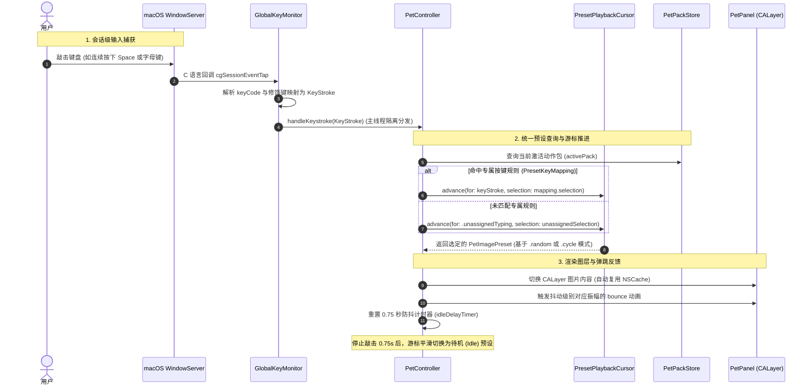
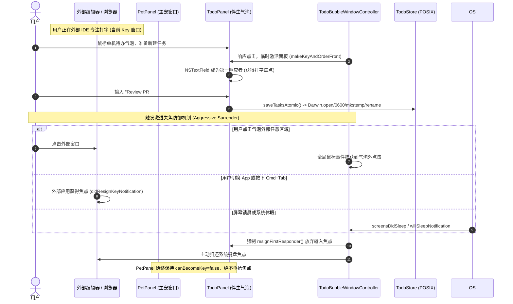
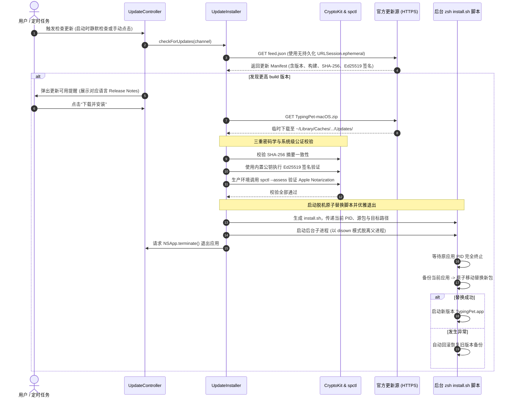

# TypingPetMac 架构设计文档

> **最后更新**：2026-10-26
>
> **基准版本**：0.19.3（构建版本 Build 35；以当前仓库代码与配置为准，ADR 保留历史演进背景）

---

## 1. 技术栈与设计哲学

### 1.1 核心技术栈

| 技术 / 框架 | 选型定位 | 说明与用途 |
| :--- | :--- | :--- |
| **Swift 6 (Swift 5 语言兼容模式)** | 核心编程语言 | 采用原生 Swift 编写，强类型安全，严格主线程并发检查（`@MainActor` 隔离）。 |
| **AppKit + SwiftUI (macOS 原生)** | 窗口与 UI 视图框架 | 提供非激活置顶面板（`PetPanel`）、伴生待办气泡面板（`TodoPanel`）、自定义鼠标事件追踪、状态栏（`NSStatusItem`）常驻；采用 SwiftUI 承载原生风格偏好设置面板（`SettingsWorkspace`）、动作包工作台（`NativeSetWorkspace`）与权限引导等界面。 |
| **QuartzCore / CoreAnimation** | 渲染与动画图层 | `CALayer` 图层驱动、`CAKeyframeAnimation` 敲击弹跳，兼顾 60Hz 刷新率与极低 CPU 占用。 |
| **CoreGraphics (`CGEventTap`)** | 全局低层级键盘监听 | 系统会话级输入监听（`.listenOnly`），仅需“输入监控”权限（`ListenEvent`），无需更宽泛的辅助功能（Accessibility）即可捕获全局击键。 |
| **ServiceManagement (`SMAppService`)** | 系统服务管理 | 现代 macOS 原生开机自启动管理，替代旧版废弃的 Login Items 方案。 |
| **CryptoKit (`Curve25519` / Ed25519 + SHA-256)** | 数字签名与安全校验 | 用于自研轻量级自动更新子系统，对更新包 Manifest 与分发归档进行高强度非对称数字签名校验。 |
| **POSIX / Darwin 底层 API** | 原子文件与持久化加固 | 伴生待办数据落盘使用 Darwin 底层 `open`（带 `O_NOFOLLOW | O_CLOEXEC` 标志）、`fchmod`（`0600` 私有权限）与 `mkstemp` 原子替换，防御符号链接攻击与写入截断。 |
| **Swift Testing (`Testing`)** | 现代测试框架 | 原生 `@Suite`、`@Test`、`#expect` 测试套件，18 个测试套件覆盖 153+ 个用例，替代传统 XCTest。 |
| **Swift Package Manager (SPM)** | 工程构建与依赖管理 | 单一轻量级 Executable Target，**零外部第三方 SPM 依赖**。 |

### 1.2 核心设计哲学

1. **绝对隐私与受控网络边界**：
   - 桌宠核心交互、键盘监听、动作包渲染与待办数据处理**100% 离线运行**，不收集、不记录、不上传任何按键内容或用户个人数据，无任何分析或遥测打点。
   - 网络能力被严格物理隔离在自研自动更新模块（`UpdateInstaller`）中，仅在用户触发或静默更新检查时通过无缓存、无 Cookie、无凭证持久化的 `URLSession.ephemeral` 会话进行，核心桌宠运行时与网络调用绝无交叉。
2. **零外部第三方依赖 (Zero External Dependencies)**：全面依赖 Apple 官方原生系统框架，不引入 Sparkle、外部网络库或庞大 UI 框架，保障启动瞬间就绪与极小安装包体积（发行包约 5MB）。
3. **极佳能耗控制 (Energy Guarding)**：桌面陪伴宠物长期在后台常驻运行，对系统能耗极其敏感。所有动画、高频指针追踪、窗口轮询均配备严格差值守卫（透明度跃迁阈值 `> 0.001`）与节流逻辑，杜绝冗余 `CATransaction` 唤醒。
4. **双窗口伴生与非激活焦点安全 (ADR-004)**：
   - 宠物主悬浮窗（`PetPanel`）严格执行非激活约束（`canBecomeKey = false`），永不抢夺系统键盘焦点；
   - 伴生待办与计时气泡（`TodoPanel`）在需输入时按需获取焦点，并在鼠标移出、窗口失焦、屏幕锁屏或系统休眠时执行**激进失焦释放（Aggressive Focus Surrender）**，保障用户日常工作流不受截获。
5. **统一动作包模型与解耦微内核 (ADR-001, ADR-003)**：
   - 启动入口轻薄（`main.swift` < 30 行），控制器、视图、物理几何、监听器与持久化各司其职；
   - 动作包抽象为统一的 `PetPackConfiguration`，支持多帧循环/随机出击、独立播放游标与预设表情映射。

---

## 2. 代码目录与文件结构

```
TypingPetMac/
├── Package.swift               # SPM 包定义（Swift 6.0 工具链，最低系统 macOS 13+）
├── AGENTS.md                   # Agent 开发指南与工程规范
├── GLOSSARY.md                 # 领域模型词汇表（规范核心实体与交互术语）
├── CHANGELOG.md                # 变更日志（遵循 Keep a Changelog 格式）
├── README.md                   # 中文使用说明与下载指引
├── README.txt                  # 简要使用说明与启动提示（随包分发）
├── LICENSE                     # MIT 开源许可证
├── ASSET_LICENSE.md            # 美术素材版权与致谢声明
├── version.json                # 集中版本号与构建编号定义 (v0.19.3, build 35)
│
├── Sources/
│   └── TypingPet/
│       ├── main.swift                 # 应用极简启动入口（@MainActor bootstrap）
│       ├── AppDelegate.swift          # NSApplicationDelegate、状态栏菜单、更新调度与伴生协调
│       ├── AppEnvironment.swift       # 编译通道、版本标识、更新公钥与调试标志隔离
│       │
│       ├── PetController.swift        # 悬浮宠物体态控制器、体态分发、惯性滑行、避让与能耗控制
│       ├── PetViews.swift             # AppKit 视图层（PetPanel、PetContentView、PetResizeHandleView）
│       ├── PetWindowGeometry.swift    # 空间几何计算、阻尼物理、对角线避让向量与屏幕停靠
│       ├── GlobalKeyMonitor.swift     # 基于 CGEventTap 的低层级全局按键监听与 MachPort 自动恢复
│       ├── PetPreferences.swift       # 集中收敛的 UserDefaults 偏好键（AppPreferencesKey/Default）
│       │
│       ├── PetPacks.swift             # 动作包统一领域模型（PetPackConfiguration, 预设, 游标, PetPackStore）
│       ├── PackEditorModel.swift      # 动作包编辑状态机与响应式视图模型
│       ├── NativeSetWorkspace.swift   # 现代原生动作包编辑工作台（画廊、出击映射、待机配置）
│       ├── PetImageLibrary.swift      # 物理图集管理、磁盘清理与 NSCache 缩略图缓存
│       ├── KeyReactions.swift         # 历史单键反应模型与兼容存储层
│       ├── ImagePicker.swift          # 随机反应图选择器，优先排除当前图像
│       │
│       ├── TodoBubbleWindowController.swift # 伴生气泡窗口控制器、锚定跟随与焦点释放生命周期
│       ├── TodoBubbleView.swift       # 动态伴生气泡 SwiftUI 视图（矢量尾巴、待办列表与计时器）
│       ├── TodoBubbleGeometry.swift   # 气泡相对定位、屏幕翻转与尾巴尖端向量计算
│       ├── TodoStore.swift            # 加固的 POSIX 原子文件持久化（todos.json 读写安全防线）
│       ├── TodoState.swift            # 伴生待办与番茄钟数据模型（TodoTask, FocusTimerState）
│       ├── FocusTimerEngine.swift     # 番茄钟/专注计时器状态机与休息提醒
│       ├── TextEditingShortcuts.swift # 独立快捷键拦截器（为无编辑菜单的 Accessory 应用补足 ⌘C/V/X/A/Z）
│       │
│       ├── UpdateController.swift     # 自研更新控制器（定时静默检查、弹窗提示与更新流调度）
│       ├── UpdateManifest.swift       # 更新清单模型（Ed25519 签名、多语言发行日志与架构路由）
│       ├── UpdateInstaller.swift      # 瞬态下载、Ed25519 验签、spctl 公证校验与后台 zsh 原子替换
│       │
│       ├── SettingsWindow.swift       # AppKit 偏好设置窗口宿主（Toolbar 与窗口样式定制）
│       ├── SettingsWorkspace.swift    # 现代原生分组偏好设置视图（通用、宠物、伴生、更新、外观）
│       ├── SettingsNavigation.swift   # 设置侧边栏导航、前进/后退历史栈与滚动标题吸顶
│       ├── InlineTitleField.swift     # 行内可编辑标题组件（支持失焦即时提交）
│       ├── BackgroundCursor.swift     # 自定义系统缩放与拖拽光标适配
│       ├── Localization.swift         # 多语言系统（支持中/繁/英/日/韩，内置名称本地化呈现）
│       ├── InputMonitoringGuide.swift # 输入监听权限引导浮窗与系统设置窗口智能吸附
│       ├── InputMonitoringGuideModel.swift # 权限引导状态机与窗口检测逻辑解耦
│       │
│       └── Resources/                 # 内置默认资源
│           ├── AppIcon.icns           # 高清多分辨率应用图标
│           ├── basic.png              # 默认待机发呆图（人渣反派七九 CP）
│           ├── left.png               # 默认敲击反应图（左手出击）
│           ├── right.png              # 默认敲击反应图（右手出击）
│           └── TypingPet.entitlements # Hardened Runtime 沙盒与系统权限权利声明
│
├── Tests/
│   └── TypingPetTests/
│       ├── PetPreferencesContractTests.swift # 偏好持久化键强类型契约测试
│       ├── DiskCleanupTests.swift            # 动作包与图集物理文件删除卫生验证
│       ├── ImageStorageFailureTests.swift    # 存储错误容错、文件名穿越防御与回滚测试
│       ├── ThumbnailCacheTests.swift          # NSCache 内存缩略图命中与生命周期测试
│       ├── PetWindowGeometryTests.swift       # 边界约束、阻尼惯性、避让算法与抖动等级测试
│       ├── KeyReactionTests.swift             # 按键映射模型序列化与哈希碰撞测试
│       ├── PetPackTests.swift                 # 动作包多帧播放、独立游标、只读内置包及迁移测试
│       ├── TodoBubbleTests.swift              # 伴生气泡锚定几何、尾巴方位与自适应翻转测试
│       ├── TodoPersistenceTests.swift         # POSIX 待办文件读写、权限约束与长文本边界测试
│       ├── FocusTimerTests.swift              # 番茄钟专注/休息计时流转与完成提醒测试
│       ├── UpdateTests.swift                  # 更新 Manifest 解析、Ed25519 验签与替换脚本测试
│       ├── SettingsAppearanceTests.swift      # 偏好设置控件样式与系统强调色响应测试
│       ├── SettingsNavigationTests.swift      # 设置窗口路由、历史导航栈与侧边栏联动测试
│       ├── LocalizationTests.swift            # 多语言翻译回退与本地化发行日志解析测试
│       ├── AppEnvironmentTests.swift          # 发布通道、版本注入与更新公钥提取测试
│       ├── InputMonitoringGuideTests.swift    # 权限引导轮询、跨窗口吸附与授权状态机测试
│       ├── FolderImageSelectionTests.swift    # 外部文件夹导入待机图与出击图智能识别测试
│       └── ImagePickerTests.swift             # 随机图像选择与空列表边界测试
│
├── scripts/
│   ├── build_app.sh            # 独立打包脚本（编译 Release/Dev、组装 Bundle、签名并打包）
│   ├── notarize_release.sh     # 苹果开发者 ID 公证、装订（Staple）与分发 Zip 打包脚本
│   ├── generate_plist.py       # 自动化 Info.plist 生成脚本（注入版本、更新公钥与标识）
│   ├── update_keys.swift       # Ed25519 密钥对生成与发布包数字签名工具
│   └── validate_manifest.swift # 更新源 feed.json 校验与多语言更新说明完备性检查
│
├── developer-notes/            # 开发者实现笔记与设计评审记录
│   ├── README.md               # 开发者笔记目录与文档规范
│   ├── preset-editor.md        # 动作包画廊、键盘映射与实时预览设计
│   ├── development.md          # 本地双通道开发、数据隔离与权限测试
│   ├── todos.md                # 伴生待办与番茄钟使用、存储加固与数据恢复
│   ├── updates.md              # 自动更新源、签名验证流程与安全规范
│   ├── developer-id.md         # 开发者证书、公证凭据与密钥配置指南
│   └── releasing.md            # 发布构建、公证、校验与版本发布流水线
│
└── docs/
    ├── architecture.md         # [本文件] 整体系统架构与设计说明
    ├── TypingPetMac-threat-model.md # 威胁建模与安全评估分析
    └── decisions/              # 技术架构决策记录 (ADRs)
        ├── ADR-001-main-decomposition.md                     # 巨石 main.swift 拆分与偏好集中化
        ├── ADR-002-in-house-secure-updater.md                # 自研轻量级安全更新子系统 vs. 第三方框架
        ├── ADR-003-unified-pet-pack-model.md                 # 动作包统一领域模型与预设表情映射
        └── ADR-004-dual-window-companion-and-focus-safety.md # 双窗口伴生架构与非激活焦点安全契约
```

---

## 3. 系统架构与依赖关系

### 3.1 全系统模块依赖拓扑图

```mermaid
graph TD
    subgraph Bootstrap & Lifecycle ["应用入口与生命周期"]
        MAIN["main.swift<br/>(@MainActor 极简启动)"] --> APP_DEL["AppDelegate.swift<br/>(生命周期与全局协调)"]
        APP_DEL --> ENV["AppEnvironment.swift<br/>(构建通道与配置隔离)"]
        APP_DEL --> MENU["NSStatusItem 菜单栏常驻"]
        APP_DEL --> SM["ServiceManagement<br/>(开机自启动)"]
    end

    subgraph Pet Runtime ["桌宠主窗口与运动引擎"]
        APP_DEL --> CTRL["PetController.swift<br/>(体态核心控制器)"]
        CTRL --> VIEWS["PetViews.swift<br/>(PetPanel / PetContentView)"]
        CTRL --> GEOM["PetWindowGeometry.swift<br/>(惯性阻尼 / 指针逃逸 / 几何计算)"]
    end

    subgraph Companion Subsystem ["双窗口伴生子系统 (ADR-004)"]
        APP_DEL --> BUBBLE_CTRL["TodoBubbleWindowController.swift<br/>(气泡窗口控制器 & 焦点释放)"]
        CTRL -. "锚点坐标通知" .-> BUBBLE_CTRL
        BUBBLE_CTRL --> BUBBLE_VIEW["TodoBubbleView.swift<br/>(SwiftUI 矢量尾巴气泡)"]
        BUBBLE_CTRL --> BUBBLE_GEOM["TodoBubbleGeometry.swift<br/>(相对锚定与边缘翻转)"]
        BUBBLE_CTRL --> FOCUS_ENG["FocusTimerEngine.swift<br/>(番茄钟专注状态机)"]
        BUBBLE_CTRL --> SHORTCUTS["TextEditingShortcuts.swift<br/>(无菜单快捷键派发)"]
        BUBBLE_CTRL --> TODO_STORE["TodoStore.swift<br/>(POSIX 原子落盘与权限加固)"]
    end

    subgraph Input System ["低层级输入体系"]
        APP_DEL --> KEY_MON["GlobalKeyMonitor.swift<br/>(底层 CGEventTap 监听)"]
        KEY_MON -. "分发 KeyStroke" .-> CTRL
        APP_DEL -. "协调权限" .-> GUIDE["InputMonitoringGuide.swift<br/>(权限引导与窗口跟随)"]
    end

    subgraph Character & Packs ["动作包与预设引擎 (ADR-003)"]
        CTRL --> PACK_STORE["PetPacks.swift<br/>(PetPackStore 动作包存储与迁移)"]
        CTRL --> CURSOR["PresetPlaybackCursor<br/>(独立通道播放游标)"]
        PACK_STORE --> LIB["PetImageLibrary.swift<br/>(物理目录管理与 NSCache)"]
        PACK_STORE --> LEGACY_KEYS["KeyReactions.swift<br/>(历史单键映射兼容层)"]
    end

    subgraph Auto Update ["自研安全自动更新子系统 (ADR-002)"]
        APP_DEL --> UPD_CTRL["UpdateController.swift<br/>(更新控制器与调度)"]
        UPD_CTRL --> UPD_INST["UpdateInstaller.swift<br/>(瞬态下载 & 校验)"]
        UPD_INST --> UPD_MANI["UpdateManifest.swift<br/>(签名清单与更新说明)"]
        UPD_INST --> CRYPTO["CryptoKit<br/>(Ed25519 + SHA-256)"]
        UPD_INST --> SPCTL["/usr/sbin/spctl<br/>(Apple Notarization 评估)"]
        UPD_INST --> SCRIPT["install.sh 独立脚本<br/>(进程退出后原子替换与回滚)"]
    end

    subgraph UI & Settings ["配置交互与多语言"]
        APP_DEL --> SETTINGS_WIN["SettingsWindow.swift<br/>(设置窗口宿主)"]
        SETTINGS_WIN --> SETTINGS_WS["SettingsWorkspace.swift<br/>(原生分组风格面板)"]
        SETTINGS_WS --> SETTINGS_NAV["SettingsNavigation.swift<br/>(侧边栏与历史栈)"]
        SETTINGS_WS --> PACK_EDITOR["NativeSetWorkspace.swift<br/>(动作包编辑工作台)"]
        SETTINGS_WS --> LOC["Localization.swift<br/>(五语言本地化引擎)"]
    end

    PREF["PetPreferences.swift<br/>(集中 UserDefaults 契约)"] -. 注入 .-> CTRL
    PREF -. 注入 .-> PACK_STORE
    PREF -. 注入 .-> BUBBLE_CTRL
    PREF -. 注入 .-> APP_DEL
```



---

### 3.2 核心运行时交互时序图

#### 时序 1：全局击键到动作包多帧分发时序 (ADR-003)



#### 时序 2：双窗口伴生与激进失焦释放时序 (ADR-004)



#### 时序 3：自研安全更新校验与原子替换时序 (ADR-002)



---

## 4. 核心子系统深度解析

### 4.1 全局低层级键盘监听与权限模型 (`GlobalKeyMonitor.swift`)

- **系统技术选型**：利用 macOS Quartz CoreGraphics 提供的 `CGEvent.tapCreate`，监听 `.cgSessionEventTap` 会话流中的 `keyDown` 事件。
- **纯监听模式 (`.listenOnly`)**：
  采用只读监听选项，不会拦截、阻断或修改系统击键传递，确保用户的日常打字没有任何输入延迟或掉键风险。
- **Unmanaged 内存安全桥接**：
  C 语言回调函数指针无法直接捕获 Swift 上下文，通过 `Unmanaged.passUnretained(self).toOpaque()` 传递 `self`，在 C 回调中安全转换回 `GlobalKeyMonitor` 实例。
- **会话失效自愈机制**：
  macOS 在系统高负载或会话切换时可能发送 `tapDisabledByTimeout` 或 `tapDisabledByUserInput`。监听器在捕获此事件后会自动调用 `CGEvent.tapEnable(tap: tap, enable: true)` 重新激活监听，保障长期驻留不掉线。
- **权限模型与免 Accessibility 策略**：
  打字宠物仅需 macOS **“输入监控” (ListenEvent)** 权限，通过 `CGPreflightListenEventAccess()` 与 `CGRequestListenEventAccess()` 触发系统申请，**完全无需申请更宽泛、高敏感的“辅助功能” (Accessibility) 权限**。

### 4.2 双窗口伴生架构与非激活焦点安全 (`PetViews.swift`, `TodoBubbleWindowController.swift`)

- **非激活主宠面板 (`PetPanel`)**：
  ```swift
  internal final class PetPanel: NSPanel {
      override var canBecomeKey: Bool { false }
      override var canBecomeMain: Bool { false }
  }
  ```
  通过覆写 `canBecomeKey` 与 `canBecomeMain` 均返回 `false`，并配置样式掩码 `[.borderless, .nonactivatingPanel]`，确保用户在点击、拖拽、缩放宠物时，**绝不抢夺用户当前正在打字的 IDE、终端或浏览器光标焦点**。
- **伴生气泡面板 (`TodoPanel`) 与激进失焦释放 (ADR-004)**：
  - 为支持任务创建与编辑，伴生气泡面板允许成为 Key 窗口（`canBecomeKey = true`）；
  - 为防止悬浮文本框意外截留外部打字，`TodoBubbleWindowController` 实施严格的失焦释放：
    1. 注册全局鼠标事件监控器，在检测到气泡框范围外的任何点击时，强制让激活的文本字段 `resignFirstResponder()`；
    2. 监听窗口失焦通知（`didResignKeyNotification`）立即注销焦点；
    3. 监听屏幕休眠（`screensDidSleepNotification`）与系统锁屏/睡眠（`willSleepNotification`），即刻重置交互状态。
- **矢量尾巴动态锚定 (`TodoBubbleGeometry.swift`)**：
  - 气泡根据宠物当前屏幕坐标与显示器边界动态计算最佳悬浮位置（上方、下方、左侧或右侧）；
  - 自动规避 macOS 屏幕边缘与 Dock 栏，当空间受限时自适应翻转方向；
  - 尾巴尖端与气泡本体采用 SwiftUI 路径自适应闭合计算，实现丝滑一体的视觉伴生体验。
- **菜单缺失环境下的快捷键直通 (`TextEditingShortcuts.swift`)**：
  在 `.accessory` 模式下，应用不占有 macOS 系统菜单栏，导致文本框无法通过全局 Edit 菜单触发常规编辑操作。`TodoPanel` 覆写 `performKeyEquivalent`，截获标准快捷键（`⌘C`、`⌘V`、`⌘X`、`⌘A`、`⌘Z`），直接通过 `NSApp.sendAction` 派发给当前文本响应者。

### 4.3 物理运动学与智能指针避让 (`PetWindowGeometry.swift`)

- **惯性滑动模拟 (`PetMotionPhysics`)**：
  - 维护采样窗口为 0.15 秒（`PetConstants.dragSampleWindow`）的鼠标拖拽序列 `[PetDragSample]`，采样滑动松手时的瞬时初速度，限制最大速度为 `900 pt/s`。
  - 按照指数时间衰减模型计算阻尼减速（`velocityRetentionPerSecond = 0.004`）。
  - 遇到当前屏幕的 `visibleFrame`（自动避开 Dock 栏与顶部菜单栏）边界时触发弹性反弹（`edgeRestitution = 0.14`）。
- **多显示器自适应指针避让 (`PetPointerAvoidance`)**：
  - 当宠物处于位置锁定且开启鼠标避让时，若全局光标距离宠物边界小于触发阈值（默认 `90 pt`），启动平滑躲避。
  - 算法以光标背向向量为基准，使用预计算的静态旋转因子向周围采样 7 个逃逸方向（`0°`, `±28°`, `±55°`, `±90°`），避免每次移动事件重复执行三角函数运算。
  - 评估函数综合考虑：远离光标距离、方向对齐度、对角线偏好（避免单纯水平/垂直呆滞移动）以及实际可位移空间，选出最佳避让坐标，并利用阻尼弹簧运动平滑溜走。

### 4.4 能耗敏感与 CoreAnimation 事务守卫 (`PetController.swift`)

- **背景与痛点**：
  为实现鼠标滑入半透明（`hoverOpacity`）与鼠标滑出常态透明（`restingOpacity`），控制器需追踪全局光标位置。若鼠标每移动 1 像素即执行一次 `CATransaction` 或查询 `UserDefaults`，会导致 CPU 频繁唤醒与 GPU 绘制浪费。
- **优化方案 (多层能耗与热路径守卫)**：
  1. **按需启停全局鼠标监控 (`updateMouseMonitoringState`)**：仅当宠物可见且满足「常驻与悬停不透明度存在差异（`> 0.001`）」或「已开启锁定状态下避开鼠标」时，才注册全局/局部鼠标移动监听器；其余状态下自动注销监听器，实现静默零鼠标唤醒。
  2. **热路径偏好内存常驻**：`scale`、`restingOpacity`、`hoverOpacity`、`avoidsPointerWhenLocked` 与 `shakeLevel` 在控制器内存中常驻缓存，仅在初始化时读取、在值变更时写回 `UserDefaults`，彻底消除鼠标移动（120Hz~1000Hz）与击键热路径上的 `UserDefaults` 查询开销。
  3. **CoreAnimation 透明度差值守卫**：
     ```swift
     private func updatePetOpacity() {
         guard panel.isVisible, let imageLayer = imageView.layer else { return }
         let targetOpacity = PetOpacityBehavior.opacity(
             isHovering: panel.frame.contains(NSEvent.mouseLocation),
             restingOpacity: cachedRestingOpacity,
             hoverOpacity: cachedHoverOpacity
         )
         guard abs(CGFloat(imageLayer.opacity) - targetOpacity) > 0.001 else { return }
         CATransaction.begin()
         CATransaction.setDisableActions(true)
         imageLayer.opacity = Float(targetOpacity)
         CATransaction.commit()
     }
     ```
     通过 `0.001` 差值判断，仅在透明度发生实际跃迁时提交事务；配合 `setDisableActions(true)` 消除隐式动画插值计算。
  4. **位置与缩放持久化节流**：拖拽、惯性滑行和指针躲避都以 60Hz 移动窗口，不在每次微小移动时写入 `UserDefaults`，仅在动作结束（`endMove` / `stopInertia` / `stopPointerAvoidance` / `endResize`）时落盘。

### 4.5 动作包统一领域模型与预设映射 (`PetPacks.swift`, `PackEditorModel.swift`, `NativeSetWorkspace.swift` - ADR-003)

- **预设抽象体系 (`PetImagePreset`)**：
  将图集中的全部图像素材标准化为强类型的预设对象，包含全局唯一 ID、显示名称、物理文件名与素材来源标记。
- **灵活播放策略 (`PresetSelection` & `PresetPlaybackMode`)**：
  - 支持绑定单个或多个预设，并提供两种播放模式：
    1. `.random`（随机出击）：概率均匀分发，同时具备连续防重机制（优先避免连续两击相同帧）；
    2. `.cycle`（序列循环）：按预设列表顺序步进轮转，完美实现左右手交替出击等连招动画。
- **独立通道播放游标 (`PresetPlaybackCursor`)**：
  按键映射（如 Space 键）、常规字母击键（未分配出击）与待机闲置循环各自拥有独立的播放游标状态，互不干扰打乱。
- **内置资产只读与编辑写时复制 (Copy-on-Edit)**：
  系统内置角色（默认小猫、人渣反派七九 CP）标记为 `builtInPresetsReadOnly`，禁止直接篡改源文件。用户点击编辑时自动触发完整动作包副本克隆，确保内置包始终完好可用。
- **双层存储适配器与无缝迁移**：
  `PetPackStore` 将动作包配置序列化为 `packs.json`，物理文件操作仍然委托给 `PetImageLibrary` 进行沙盒目录隔离与物理清理。初次升级时，系统会自动将旧版本散装图集和按键规则无损转换为动作包。

### 4.6 专注计时器与代办事项引擎 (`FocusTimerEngine.swift`, `TodoStore.swift`)

- **番茄钟专注状态机 (`FocusTimerEngine`)**：
  - 维护待机、专注中、专注暂停、休息中、休息暂停五种标准状态；
  - 倒计时结束时触发系统本地通知、视觉提示以及伴生气泡状态切换；
  - 自动累加每日专注总时长，并随日期变更自动重置当天统计。
- **POSIX 底层原子落盘与安全加固 (`TodoStore.swift`)**：
  - 针对 `~/Library/Application Support/TypingPet/todos.json` 的读写进行全面安全加固：
    1. **拒绝符号链接**：通过底层 Darwin `open` 配合 `O_RDONLY | O_NOFOLLOW | O_NONBLOCK | O_CLOEXEC` 打开文件句柄，严防符号链接劫持；
    2. **物理文件校验与大小截断**：通过 `fstat` 确认目标为普通文件，并硬性限制最大文件尺寸为 10 MiB，防范恶意构造巨型文件耗尽内存；
    3. **私有权限约束**：写入临时文件后，通过 `fchmod` 显式设置 `0600`（仅当前用户可读写）权限；
    4. **原子替换**：采用 `mkstemp` 生成同目录临时文件并写入，完成后通过原子 `rename` 覆盖目标文件，杜绝写入中断导致的数据损毁。

### 4.7 自研轻量级安全更新子系统 (`UpdateController.swift`, `UpdateInstaller.swift`, `UpdateManifest.swift` - ADR-002)

- **严格受限的网络边界**：
  网络请求仅限更新模块使用无状态的 `URLSession.ephemeral`，不复用连接缓存，不使用凭证，核心桌宠运行时与网络调用绝无交叉。
- **四阶安全校验流水线**：
  1. **Manifest 结构校验**：验证版本号递增逻辑、安全下载 URL（强制 HTTPS）、哈希与签名非空；
  2. **SHA-256 完整性校验**：下载归档后比对哈希值；
  3. **Ed25519 非对称签名验签**：利用 `CryptoKit.Curve25519.Signing.PublicKey` 校验 Manifest 中所附签名的有效性；
  4. **Apple Developer ID 与 Gatekeeper 公证评估**：对于正式发布包，调用 `/usr/sbin/spctl --assess --type execute` 检验解压出的 `.app` 包体，核验 Team Identifier 与运行中进程完全一致。
- **脱机原子替换助手脚本 (`install.sh`)**：
  下载解压完成后，生成临时 zsh 脚本并在独立进程中启动（`disown`）。脚本等待主进程完全退出后，将原 `.app` 备份为 `.app.old`，将新包原子移动到安装路径，若替换失败则自动还原旧版本。

### 4.8 原生偏好设置与多语言本地化体系 (`SettingsWorkspace.swift`, `Localization.swift`)

- **macOS 原生 HIG 分组风格**：
  偏好设置面板全面遵循 macOS 原生设计语言，采用原生开关（`Toggle`）、标准分组行布局、对齐操作控件，并深度跟随 macOS 系统强调色（Accent Color）。
- **侧边栏导航与历史栈 (`SettingsNavigation.swift`)**：
  支持双栏侧边栏布局，配备前进/后退历史栈导航，设置长列表滚动时标题自动吸顶并固定于窗口工具栏。
- **多语言本地化引擎 (`Localization.swift`)**：
  内置支持简体中文（zh-Hans）、繁体中文（zh-Hant）、英语（en）、日语（ja）与韩语（ko）五种语言。内置图集与预设名称跟随当前应用语言动态呈现，但不修改持久化的底层标识与用户自定义名称。

### 4.9 权限引导与系统设置智能跟随 (`InputMonitoringGuide.swift`, `InputMonitoringGuideModel.swift`)

- **跨窗口跟随机制**：
  利用 Quartz 窗口服务（`CGWindowListCopyWindowInfo`）检测当前屏幕上打开的“系统设置”窗口位置。浮窗自动置顶吸附在系统设置窗口右侧或左侧，无需用户盲目寻找。
- **窗口轮询能耗平衡**：
  将高频全屏窗口遍历调整为 0.6s 省电轮询，在保证吸附平滑的同时减少电量消耗。
- **交互创新**：
  不仅提供直达设置页面的跳转协议（`x-apple.systempreferences:...`），还支持直接将引导窗口中的宠物图标拖拽进系统设置的输入监听列表中，降低用户认知门槛。

---

## 5. 核心架构决策记录 (ADRs)

关于本项目重大技术选择的详细权衡和设计细节，请参阅 **[技术决策记录 (ADRs)](./decisions/)**：

1. **[ADR-001: 巨石 main.swift 模块化拆分与配置中心收敛](./decisions/ADR-001-main-decomposition.md)** — 将 1,397 行单文件解耦为单职责组件、建立 `PetPreferences` 集中配置并设立代码行数预算，彻底解决单元测试隔离与能耗守卫问题。
2. **[ADR-002: 自研轻量级安全更新子系统 vs. 第三方框架](./decisions/ADR-002-in-house-secure-updater.md)** — 阐明在维持 100% 离线隐私与零外部 SPM 依赖约束下，采用 `URLSession.ephemeral` + `CryptoKit` (Ed25519) + `spctl` 公证与后置原子替换脚本的架构选型。
3. **[ADR-003: 动作包统一领域模型与预设表情映射](./decisions/ADR-003-unified-pet-pack-model.md)** — 将分散的旧版图集目录与按键规则收敛为统一的 `PetPackConfiguration` 动作包，支持多帧循环/随机播放、独立游标与内置素材只读保护。
4. **[ADR-004: 双窗口伴生架构与非激活焦点安全契约](./decisions/ADR-004-dual-window-companion-and-focus-safety.md)** — 确立桌宠主窗口（`PetPanel`，绝对非 Key）与伴生待办气泡（`TodoPanel`，临时可 Key）的双窗口分离，结合失焦/锁屏/点击外部主动释放焦点的安全防线，杜绝误截获用户打字。

---

## 6. 构建、打包、签名与分发流程

### 6.1 常用开发指令表

| 命令 | 用途说明 |
| :--- | :--- |
| `swift build` | 编译 Debug 调试二进制产物（位于 `.build/debug/TypingPet`） |
| `SDKROOT=... TMPDIR=... swift test --disable-sandbox` | 执行全量单元测试与合约测试套件（匹配 SDK 与临时目录） |
| `swift test --filter <TestName>` | 针对性运行单个测试套件（如 `swift test --filter PetPackTests`） |
| `./scripts/build_app.sh` | 编译 Release 产物、组装 `dist/TypingPet.app` 包结构并执行代码签名 |
| `TYPINGPET_BUILD_CHANNEL=development ./scripts/build_app.sh` | 编译构建用于本地联调的开发版 `dist/TypingPet Dev.app` |
| `./scripts/notarize_release.sh` | 提交苹果官方 Notary Service 公证并执行票据装订（Stapling） |
| `xattr -cr /Applications/TypingPet.app` | 清除 Gatekeeper 隔离属性（解决本地测试未签名包提示“已损坏”问题） |
| `tccutil reset ListenEvent` | 重置当前系统“输入监听”权限状态，用于测试首次授权引导流程 |

### 6.2 独立打包脚本 (`scripts/build_app.sh`)

打包脚本执行严格的流水线构建：
1. **SDK 自动探测**：若存在兼容性 SDK（如 `MacOSX26.5.sdk`），自动导出 `SDKROOT` 环境变量。
2. **Release / Dev 双通道编译**：
   - 生产通道（`production`）：生成标准 `TypingPet.app`，Bundle ID 为 `ing.miel.typingpet`，剥离调试符号；
   - 开发通道（`development`）：生成 `TypingPet Dev.app`，Bundle ID 为 `ing.miel.typingpet.dev`，支持与正式版共存并隔离数据。
3. **Bundle 目录装配**：
   - 清理旧的输出目录，装配 `Contents/MacOS` 与 `Contents/Resources`。
   - 复制主可执行二进制文件以及内置资源（`*.png`, `*.icns`, `Localization/*.lproj`）。
4. **生成 `Info.plist` (`scripts/generate_plist.py`)**：
   - 注入包名、最低系统版本 `13.0` 与构建编号；
   - 启用 `LSUIElement = true`（纯菜单栏常驻与浮窗运行，不在 Dock 栏占位）；
   - 自动注入对应的 Ed25519 自动更新公钥（`update_public_key`）与 Team ID。
5. **代码签名 (Code Signing)**：
   - 优先探测开发者电脑上的 `Developer ID Application` 证书并签署安全运行时（`--options runtime --timestamp`），挂载 Hardened Runtime 权利文件 `TypingPet.entitlements`。
   - 若无开发者证书，回退至 Ad-hoc 本地签名（`-`）。

### 6.3 官方公证流程 (`scripts/notarize_release.sh`)

对于面向公众分发的正式版本，必须经过 Apple 官方公证：
1. 校验 `.app` 已经过正式 Developer ID 签名。
2. 使用 `ditto` 打包隔离临时 Zip 文件。
3. 调用 `xcrun notarytool submit ... --keychain-profile typingpet-notary --wait` 上传至 Apple 服务器审计。
4. 审计通过后，执行 `xcrun stapler staple "$app_path"` 将苹果公证票据离线装订至应用包体中。
5. 最终通过 `spctl --assess --type execute` 检验 Gatekeeper 放行状态，输出最终分发 Zip。

---

## 7. 质量保障体系与测试矩阵

本项目全面采用 Swift 6 原生 **Swift Testing** 框架（`import Testing`），截至 v0.19.3 包含 18 个测试套件、153+ 个自动化测试：

| 测试套件文件 | 覆盖领域 | 核心校验点 |
| :--- | :--- | :--- |
| `PetPreferencesContractTests` | 配置持久化契约 | 确保所有读写均经由 `AppPreferencesKey` 常量，杜绝字符串字面量漂移与配置遗失。 |
| `DiskCleanupTests` | 磁盘文件卫生 | 验证删除动作包、图集目录及按键绑定后，`Application Support` 目录下的物理文件被彻底清理。 |
| `ImageStorageFailureTests` | 存储错误与防穿越 | 验证文件名路径穿越攻击防御（`StoredFileName`）、存储空间不足容错、复制中断回滚与删除重试。 |
| `ThumbnailCacheTests` | 图像缓存生命周期 | 验证基于 `NSCache` 的缩略图缓存命中、内存驱逐与动作包切换时的显式内存释放。 |
| `PetWindowGeometryTests` | 空间几何与物理运算 | 验证透明度计算、屏幕可视区约束、指针躲避目标评分、拖拽惯性阻尼与弹跳振幅。 |
| `KeyReactionTests` | 按键映射与模型哈希 | 验证 `KeyStroke` 模型哈希、快捷键描述文本生成、JSON 序列化与冲突覆盖判定。 |
| `PetPackTests` | 动作包播放与映射引擎 | 验证多帧出击 `.cycle` 步进、`.random` 防重机制、独立游标隔离、内置包只读保护与旧版平滑迁移。 |
| `TodoBubbleTests` | 伴生气泡几何与自适应 | 验证气泡相对宠物的相对定位计算、屏幕边缘自适应翻转与矢量尾巴锚定点。 |
| `TodoPersistenceTests` | 待办数据底层存储 | 验证 POSIX `open`/`0600`/`mkstemp` 原子落盘、普通文件校验、10 MiB 大小上限与超长文本保护。 |
| `FocusTimerTests` | 专注与番茄钟引擎 | 验证专注/休息倒计时状态机、暂停与恢复、自然完成提醒与今日专注时长自动累加。 |
| `UpdateTests` | 自动更新子系统安全 | 验证 Manifest 解析、多语言 Release Notes 匹配、Ed25519 签名拦截、spctl 证书断言与安装脚本语法。 |
| `SettingsAppearanceTests` | 设置界面视觉规范 | 验证原生分组风格、控件高度对齐、系统强调色联动与文本换行保护。 |
| `SettingsNavigationTests` | 设置侧边栏与导航栈 | 验证侧边栏分栏跳转、历史前进/后退栈、标题吸顶固定与视图状态恢复。 |
| `LocalizationTests` | 多语言系统与文本 | 验证五种语言（中/繁/英/日/韩）文本完备性、回退策略与内置包名称动态本地化。 |
| `AppEnvironmentTests` | 环境通道与配置注入 | 验证开发版（`development`）与正式版（`production`）数据隔离、更新源地址解析与公钥提取。 |
| `InputMonitoringGuideTests` | 权限引导与窗口跟随 | 验证权限预检（Preflight）、引导状态机流转、低频轮询节流与系统设置窗口吸附。 |
| `FolderImageSelectionTests` | 外部图集智能导入推断 | 验证从外部文件夹解析图像，智能匹配待机图（`basic`、`idle`）与反应图。 |
| `ImagePickerTests` | 反应图随机选择 | 验证优先排除当前帧的随机挑选算法与单图回退逻辑。 |

> [!IMPORTANT]
> **CI / Headless 无头环境测试隔离准则**：  
> `CGEventTap` 依赖活跃的 macOS WindowServer 会话与真实用户权限。**严禁在自动化单元测试中通过 CGEventTap 模拟发送真实硬件按键**。输入监听系统的测试必须严格聚焦在 `KeyStroke` 模型转换、状态机流转与控制器反应层。

---

## 8. 隐私与安全边界声明

1. **绝对离线隐私保证 (100% Offline Core)**：
   - 桌面陪伴宠物的主运行时（体态、动画、几何运算、按键捕获、待办管理与番茄钟）**完全不包含任何网络请求代码**。
   - 应用不记录击键历史、不记录输入内容、不收集按键速率、不上报任何遥测或崩溃日志，彻底免除键盘记录器（Keylogger）风险。
2. **严格隔离的自研更新网络边界**：
   - 应用唯一的网络交互代码存在于更新模块（`UpdateInstaller`），采用 `URLSession.ephemeral` 会话，不存储 Cookie 或用户凭据；
   - 更新仅与发布源通信（检查 `feed.json` 与下载安装包），并受 Ed25519 非对称密码学签名与 Apple Notarization 双重背书，无法被用于下发非授权恶意代码。
3. **文件系统与持久化加固**：
   - 自定义图集与规则目录严格限制在 `~/Library/Application Support/TypingPet/` 沙盒路径下；
   - 所有文件名均经由 `StoredFileName.isSafe` 检验，拦截任何可能导致目录穿越的相对路径或特殊字符；
   - 伴生待办文件读写通过 POSIX 句柄执行安全检查（`O_NOFOLLOW` 拦截符号链接，`0600` 限制本用户私有访问，`10 MiB` 硬性防爆门限）。
4. **源码与路径隐私**：
   在 Release 二进制构建中，严禁泄露开发者本地绝对路径。所有涉及源码位置的 `#filePath` 必须置于 `#if DEBUG` 条件编译块内，保障分发二进制的干净与安全。
