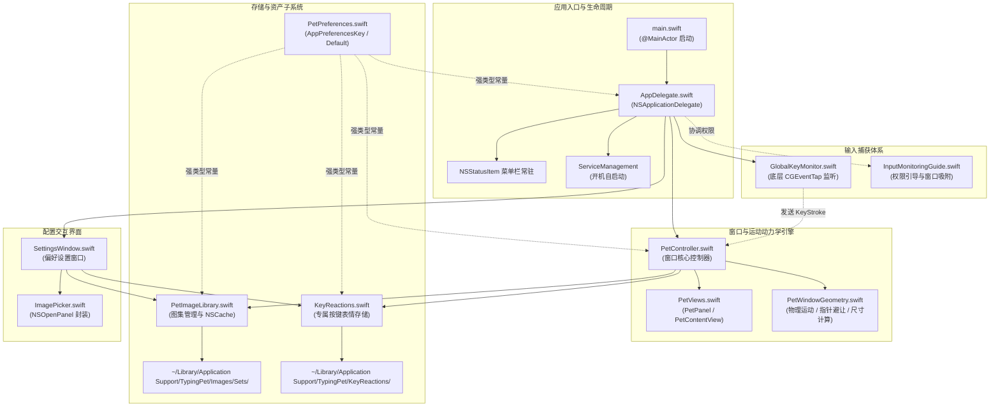
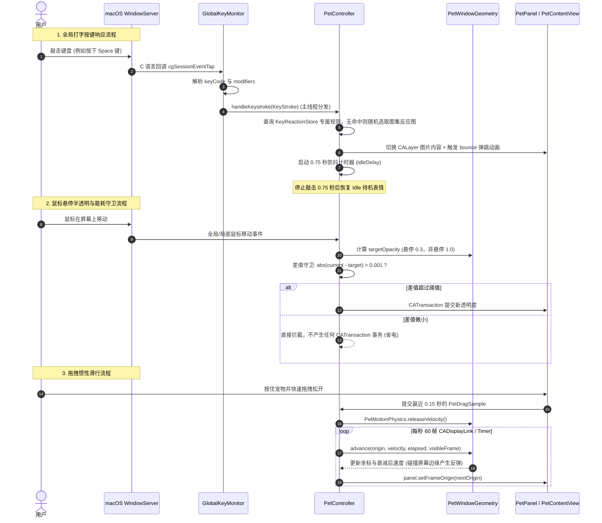

# TypingPetMac 架构设计文档

> **最后更新**：2026-10-18
>
> **基准版本**：0.12.2（以当前仓库代码与配置为准；ADR 保留历史决策背景）

---

## 1. 技术栈与设计哲学

### 1.1 核心技术栈

| 技术 / 框架 | 选型定位 | 说明与用途 |
| :--- | :--- | :--- |
| **Swift 6 (Swift 5 兼容模式)** | 核心编程语言 | 采用原生 Swift 编写，类型安全，严格并发检查（`@MainActor` 隔离）。 |
| **AppKit + SwiftUI (macOS 原生)** | 窗口与 UI 视图框架 | 提供非激活置顶面板（`NSPanel`）、自定义鼠标事件追踪、状态栏（`NSStatusItem`）常驻；采用 `NSHostingController` 承载偏好设置与权限引导等 SwiftUI 界面。 |
| **QuartzCore / CoreAnimation** | 渲染与动画图层 | `CALayer` 图层驱动、`CAKeyframeAnimation` 敲击弹跳，兼顾超高刷新率与极低 CPU 占用。 |
| **CoreGraphics (`CGEventTap`)** | 全局低层级键盘监听 | 系统会话级输入监听（`.listenOnly`），无需辅助功能（Accessibility）即可捕获全局击键。 |
| **ServiceManagement (`SMAppService`)** | 系统服务管理 | 现代 macOS 原生开机自启动管理，替代旧版废弃的 Login Items 方案。 |
| **Swift Testing (`Testing`)** | 现代测试框架 | 原生 `@Suite`、`@Test`、`#expect` 测试套件，替代传统 XCTest。 |
| **Swift Package Manager (SPM)** | 工程构建与依赖管理 | 单一轻量级 Executable Target，零外部第三方 SPM 依赖。 |

### 1.2 核心设计哲学

1. **绝对隐私与 100% 离线保障**：应用内部**零网络请求**（无 `URLSession`，无网络 API），不收集、不记录、不上传任何按键内容与用户数据。
2. **零外部第三方依赖 (Zero External Dependencies)**：全面依赖 Apple 官方原生系统框架，避免引入臃肿庞大的第三方库，保证启动瞬间就绪与极小安装包体积。
3. **极佳能耗控制 (Energy Guarding)**：桌面陪伴宠物长期在后台常驻运行，对系统能耗极其敏感。所有动画、高频指针追踪、窗口轮询均配备严格差值守卫与节流逻辑，杜绝冗余 `CATransaction` 唤醒。
4. **非侵入式极简交互**：宠物悬浮窗永不抢夺系统键盘焦点；支持锁定状态下的点击穿透（Click-Through）与智能指针逃逸，陪伴而不打扰工作流。
5. **微内核与单职责架构 (ADR-001)**：启动入口轻薄（< 20 行），控制器、视图、物理几何、监听器与持久化各司其职，每个解耦模块严格限制在 650 行以内。

---

## 2. 代码目录与文件结构

```
TypingPetMac/
├── Package.swift               # SPM 包定义（Swift 6.0 工具链，最低系统 macOS 13+）
├── AGENTS.md                   # Agent 开发指南与工程规范
├── GLOSSARY.md                 # 领域模型词汇表（规范核心实体与交互术语）
├── CHANGELOG.md                # 变更日志（遵循 Keep a Changelog 格式）
├── README.md                   # 中文使用说明与下载指引
├── README.txt                  # 简要使用说明与启动提示（随包分发）
├── LICENSE                     # MIT 开源许可证
├── ASSET_LICENSE.md            # 美术素材版权与致谢声明
│
├── Sources/
│   └── TypingPet/
│       ├── main.swift                 # 应用极简启动入口（@MainActor bootstrap）
│       ├── AppDelegate.swift          # NSApplicationDelegate、状态栏菜单与权限协调
│       ├── PetController.swift        # 悬浮宠物体态控制器、惯性滑行、避让与能耗控制
│       ├── PetViews.swift             # AppKit 视图层（PetPanel、PetContentView、PetResizeHandleView）
│       ├── PetWindowGeometry.swift    # 几何计算、阻尼物理、对角线避让向量与屏幕停靠
│       ├── GlobalKeyMonitor.swift     # 基于 CGEventTap 的低层级全局按键监听与 MachPort 维护
│       ├── PetPreferences.swift       # 集中收敛的 UserDefaults 偏好键（AppPreferencesKey/Default）
│       ├── PetImageLibrary.swift      # 图集管理、多角色切换、磁盘清理与 NSCache 图像缓存
│       ├── KeyReactions.swift         # 独立按键规则管理（绑定单键/快捷键特定动作）与存储
│       ├── SettingsWindow.swift       # SwiftUI + AppKit NSHostingController 偏好设置面板（4 点网格规范）
│       ├── InputMonitoringGuide.swift # 输入监听权限引导浮窗与系统设置窗口智能跟随
│       ├── ImagePicker.swift          # 随机反应图选择，优先排除当前图像
│       └── Resources/                 # 内置默认资源
│           ├── AppIcon.icns           # 高清多分辨率应用图标
│           ├── basic.png              # 默认待机发呆图（人渣反派七九 CP）
│           ├── left.png               # 默认敲击反应图（左手出击）
│           └── right.png              # 默认敲击反应图（右手出击）
│
├── Tests/
│   └── TypingPetTests/
│       ├── PetPreferencesContractTests.swift # 偏好持久化键强类型契约测试
│       ├── DiskCleanupTests.swift            # 图集与按键动作物理删除卫生验证
│       ├── ImageStorageFailureTests.swift    # 迁移、失败清理、删除重试与设置状态同步
│       ├── ThumbnailCacheTests.swift          # NSCache 内存缩略图命中与失效测试
│       ├── PetWindowGeometryTests.swift       # 边界约束、阻尼惯性与几何算法测试
│       ├── KeyReactionTests.swift             # 按键动作录制、快捷键序列化与映射测试
│       ├── FolderImageSelectionTests.swift    # 图集文件夹导入及 basic/idle 自动识别测试
│       └── ImagePickerTests.swift             # 随机图像选择与空列表边界测试
│
├── scripts/
│   ├── build_app.sh            # 独立打包脚本（编译 Release、组装 Bundle、Info.plist 与代码签名）
│   └── notarize_release.sh     # 苹果开发者 ID 公证、装订（Staple）与分发 Zip 打包脚本
│
└── docs/
    ├── architecture.md         # [本文件] 整体系统架构与设计说明
    ├── decisions/              # 技术架构决策记录 (ADRs)
    │   ├── ADR-001-main-decomposition.md                     # 巨石 main.swift 拆分与偏好集中化
    │   ├── ADR-002-in-house-secure-updater.md                # 自研轻量级安全更新子系统 vs. 第三方框架
    │   ├── ADR-003-unified-pet-pack-model.md                 # 动作包统一领域模型与预设表情映射
    │   └── ADR-004-dual-window-companion-and-focus-safety.md # 双窗口伴生架构与非激活焦点安全契约
    └── archive/                # 历史归档文档
        └── fix_plan.md         # 历史代码质量审计与全量修复计划
```

---

## 3. 系统架构与依赖关系

### 3.1 模块依赖架构图



### 3.2 核心运行时数据流



---

## 4. 核心子系统深度解析

### 4.1 全局无感按键监听与权限模型 (`GlobalKeyMonitor.swift`)

- **系统技术选型**：利用 macOS Quartz CoreGraphics 提供的 `CGEvent.tapCreate`，监听 `.cgSessionEventTap` 会话流中的 `keyDown` 事件。
- **纯监听模式 (`.listenOnly`)**：
  采用只读监听选项，不会拦截、阻断或修改系统击键传递，确保用户的日常打字没有任何输入延迟或掉键风险。
- **Unmanaged 内存安全桥接**：
  C 语言回调函数指针无法直接捕获 Swift 上下文，通过 `Unmanaged.passUnretained(self).toOpaque()` 传递 `self`，在 C 回调中安全转换回 `GlobalKeyMonitor` 实例。
- **会话失效自愈机制**：
  macOS 在系统高负载或会话切换时可能发送 `tapDisabledByTimeout` 或 `tapDisabledByUserInput`。监听器在捕获此事件后会自动调用 `CGEvent.tapEnable(tap: tap, enable: true)` 重新激活监听，保障长期驻留不掉线。
- **权限模型与免 Accessibility 策略**：
  打字宠物仅需 macOS **“输入监控” (ListenEvent)** 权限，通过 `CGPreflightListenEventAccess()` 与 `CGRequestListenEventAccess()` 触发系统申请，**完全无需申请更宽泛、高敏感的“辅助功能” (Accessibility) 权限**。

### 4.2 无焦点透明悬浮窗体系 (`PetViews.swift`)

- **非激活面板 (`PetPanel`)**：
  ```swift
  internal final class PetPanel: NSPanel {
      override var canBecomeKey: Bool { false }
      override var canBecomeMain: Bool { false }
  }
  ```
  通过覆写 `canBecomeKey` 与 `canBecomeMain` 均返回 `false`，并配置样式掩码 `[.borderless, .nonactivatingPanel]`，确保用户在点击、拖拽、缩放宠物时，**绝不抢夺用户当前正在打字的 IDE、终端或浏览器光标焦点**。
- **位置锁定与点击穿透 (Click-Through)**：
  当用户开启“锁定位置”后，控制器将窗口的 `panel.ignoresMouseEvents = true`，鼠标点击直接穿透到宠物后方的底层应用。
- **对角线缩放把柄 (`PetResizeHandleView`)**：
  - 在 macOS 15+ 优先采用原生对角缩放光标 `NSCursor.frameResize(position: .topRight, directions: .all)`，低版本降级为 `NSCursor.resizeLeftRight`。
  - 支持完整的无障碍标注（`setAccessibilityLabel` / `setAccessibilityHelp`）与触摸板/鼠标手势拖拽缩放。

### 4.3 物理运动学与智能指针避让 (`PetWindowGeometry.swift`)

- **惯性滑动模拟 (`PetMotionPhysics`)**：
  - 维护采样窗口为 0.15 秒（`PetConstants.dragSampleWindow`）的鼠标拖拽序列 `[PetDragSample]`，采样滑动松手时的瞬时初速度，限制最大速度为 `900 pt/s`。
  - 按照指数时间衰减模型计算阻尼减速（`velocityRetentionPerSecond = 0.004`）。
  - 遇到当前屏幕的 `visibleFrame`（自动避开 Dock 栏与顶部菜单栏）边界时触发弹性反弹（`edgeRestitution = 0.14`）。
- **多显示器自适应指针避让 (`PetPointerAvoidance`)**：
  - 当宠物处于位置锁定且开启鼠标避让时，若全局光标距离宠物边界小于触发阈值（默认 `90 pt`），启动平滑躲避。
  - 算法以光标背向向量为基准，使用预计算的静态旋转因子（`rotationFactors`）向周围采样 7 个逃逸方向（`0°`, `±28°`, `±55°`, `±90°`），避免每次移动事件重复执行三角函数运算。
  - 评估函数综合考虑：远离光标距离、方向对齐度、对角线偏好（避免单纯水平/垂直呆滞移动）以及实际可位移空间，选出最佳避让坐标，并利用阻尼弹簧运动平滑溜走。

### 4.4 能耗敏感与 CoreAnimation 事务守卫 (`PetController.swift`)

- **背景与痛点**：
  为实现鼠标滑入半透明（`hoverOpacity`）与鼠标滑出常态透明（`restingOpacity`），控制器需追踪全局光标位置。若鼠标每移动 1 像素即执行一次 `CATransaction` 或查询 `UserDefaults`，会导致 CPU 频繁唤醒与 GPU 绘制浪费。
- **优化方案 (多层能耗与热路径守卫)**：
  1. **按需启停全局鼠标监控 (`updateMouseMonitoringState`)**：仅当宠物可见且满足「常驻与悬停不透明度存在差异（`> 0.001`）」或「已开启锁定状态下避开鼠标」时，才注册全局/局部鼠标移动监听器；其余状态下自动注销监听器，实现静默零鼠标唤醒。
  2. **热路径偏好内存常驻**：`scale`、`restingOpacity`、`hoverOpacity`、`avoidsPointerWhenLocked` 与 `shakeLevel` 在控制器内存中常驻缓存，仅在初始化时读取、在值变更时写回 `UserDefaults`，彻底消除鼠标移动（120Hz~1000Hz）与击键热路径上的 `UserDefaults` 查询开销。
  3. **CoreAnimation 透明度差值守卫**：
     ```swift
     private func updatePetOpacity() {
         guard panel.isVisible, let imageLayer = imageView.layer else { return }
         let targetOpacity = PetOpacityBehavior.opacity(
             isHovering: panel.frame.contains(NSEvent.mouseLocation),
             restingOpacity: cachedRestingOpacity,
             hoverOpacity: cachedHoverOpacity
         )
         guard abs(CGFloat(imageLayer.opacity) - targetOpacity) > 0.001 else { return }
         CATransaction.begin()
         CATransaction.setDisableActions(true)
         imageLayer.opacity = Float(targetOpacity)
         CATransaction.commit()
     }
     ```
     通过 `0.001` 差值判断，仅在透明度发生实际跃迁时提交事务；配合 `setDisableActions(true)` 消除隐式动画插值计算。同时在 60Hz 指针躲避计时器运行期间，短路鼠标移动事件触发的冗余 `targetOrigin` 计算。
- **位置与缩放持久化**：
  拖拽、惯性滑行和指针躲避都以 60Hz 移动窗口，因此不在每次移动时写入 `UserDefaults`。窗口位置只在 `endMove` / `stopInertia` / `stopPointerAvoidance` / `endResize` 等动作结束时保存；拖拽缩放与设置面板缩放滑块均使用无阻塞更新（`animate: false`），消除连续拖动时的窗口动画卡顿。惯性、躲避与弹跳参数集中在 `PetConstants`。
  屏幕配置变化时先停止惯性与指针避让、清除旧运动边界，再将窗口限制到当前屏幕可视区，避免后续定时器覆盖归位结果。

### 4.5 集中配置与磁盘生命周期 (`PetPreferences.swift`, `PetImageLibrary.swift`, `KeyReactions.swift`)

- **集中式配置契约 (`PetPreferences.swift`)**：
  收敛所有 13 个 `UserDefaults` 持久化键至 `AppPreferencesKey`，所有数值范围、预设与回退默认值至 `AppPreferencesDefault`。彻底杜绝裸字符串字面量（Magic Strings）引起的拼写错误与契约漂移。
- **存储路径隔离**：
  - 自定义图集隔离目录：`~/Library/Application Support/TypingPet/Images/Sets/<UUID>/`
  - 独立按键动作目录：`~/Library/Application Support/TypingPet/KeyReactions/`
  - 图库与规则中的文件名、目录名来自 `UserDefaults`，读取和删除前都经过 `StoredFileName.isSafe` 校验，只接受单级名称（拒绝空串、`.`、`..` 与含 `/` 的名称），不合法的条目按缺失处理，不会解析到存储目录之外。
- **磁盘物理卫生保障**：
  删除图集（`PetImageLibrary.deleteSet`）或删除/覆盖按键绑定（`KeyReactionStore.removeRule` / `setRule`）时，同步清理应用存储中的目录与孤立文件。删除失败会向调用方抛出错误，保留图库或规则记录，以便重试；设置窗口会显示错误。旧版图集只清理 `Images/` 下不再被其他图集引用的文件，不删除共享目录或用户源图像。该行为由 `DiskCleanupTests` 和 `ImageStorageFailureTests` 验证。
- **导入与替换的失败处理**：
  图集替换先在新目录准备待机图和反应图，保留未替换的图片，再清理旧存储并更新图库与当前选择。这也让旧版图集在迁入 `Sets/` 时保留另一组图片。导入或复制失败会清理新副本；从默认图集发起的失败替换不会创建图库记录或切换选择。按键规则覆盖会先复制新图，旧文件清理失败时清理新副本并保留原规则。
- **显示缓存、O(1) 规则查找与图集切换内存卫生**：
  - `PetImageLibrary` 使用系统托管的 `NSCache<NSURL, NSImage>` 缓存图像，宠物显示与设置缩略图共同复用。替换或删除图集时显式清除旧图像的缓存；切换激活图集（`activateSet`）时自动清理上一图集的非待机反应帧缓存（保留待机缩略图供图库流畅展示），防止高分辨率反应图长期驻留内存。
  - `KeyReactionStore` 维护 `[KeyStroke: URL]` 内存字典索引（`ruleURLsByStroke`），使每次击键的专属规则匹配达到 O(1) 且未命中规则时零磁盘 `stat` 开销；索引保留安全路径，图像文件缺失时返回 `nil`，文件恢复后自动重新命中，包括启动时文件缺失的情况。
  - `PetController` 在初始化和 `reloadImages()` 时预构建 `reactionPicker` 与路径映射字典 `reactionURLsByPath`，并在 `showImage(at:)` 中对相同图像路径直接短路，消除击键路径中的临时数组分配与重复图层赋值。
- **设置状态同步**：
  `TypingPetSettingsModel.refresh()` 通过 `AppDelegate` 注入的 `currentPositionLock` 回调读取控制器的实际锁定状态，使菜单栏修改后重新打开或刷新设置窗口时，锁定开关及鼠标避让选项的启用状态保持一致。

### 4.6 智能权限引导浮窗 (`InputMonitoringGuide.swift`)

- **跨窗口跟随机制**：
  利用 Quartz 窗口服务（`CGWindowListCopyWindowInfo`）检测当前屏幕上打开的“系统设置”窗口位置。浮窗自动置顶吸附在系统设置窗口右侧或左侧，无需用户盲目寻找。
- **窗口轮询能耗平衡**：
  将早期版本的 120ms 高频全屏窗口遍历调整为 0.6s 省电轮询，在保证吸附平滑的同时减少电量消耗。
- **交互创新**：
  不仅提供直达设置页面的跳转协议（`x-apple.systempreferences:...`），还支持直接将引导窗口中的宠物图标拖拽进系统设置的输入监听列表中，降低用户认知门槛。

---

## 5. 核心架构决策记录 (ADRs)

关于本项目重大技术选择的详细权衡和设计细节，请参阅 **[技术决策记录 (ADRs)](./decisions/)**：

1. **[ADR-001: 巨石 main.swift 模块化拆分与配置中心收敛](./decisions/ADR-001-main-decomposition.md)** — 将 1,397 行单文件解耦为单职责组件、建立 `PetPreferences` 集中配置并设立代码行数预算，彻底解决单元测试隔离与能耗守卫问题。
2. **[ADR-002: 自研轻量级安全更新子系统 vs. 第三方框架](./decisions/ADR-002-in-house-secure-updater.md)** — 阐明在维持 100% 离线隐私与零外部 SPM 依赖约束下，采用 `URLSession.ephemeral` + `CryptoKit` (Ed25519) + `spctl` 公证与后置原子替换脚本的架构选型。
3. **[ADR-003: 动作包统一领域模型与预设表情映射](./decisions/ADR-003-unified-pet-pack-model.md)** — 将分散的旧版图集目录与按键规则收敛为统一的 `PetPackConfiguration` 动作包，支持多帧循环/随机播放、独立游标与内置素材只读保护。
4. **[ADR-004: 双窗口伴生架构与非激活焦点安全契约](./decisions/ADR-004-dual-window-companion-and-focus-safety.md)** — 确立桌宠主窗口（`PetPanel`，绝对非 Key）与伴生待办气泡（`TodoPanel`，临时可 Key）的双窗口分离，结合失焦/锁屏/点击外部主动释放焦点的安全防线，杜绝误截获用户打字。

---

## 6. 构建、打包、签名与分发流程

### 6.1 常用开发指令表

| 命令 | 用途说明 |
| :--- | :--- |
| `swift build` | 编译 Debug 调试二进制产物（位于 `.build/debug/TypingPet`） |
| `swift test` | 执行全量单元测试与合约测试套件 |
| `swift test --filter <TestName>` | 针对性运行单个测试套件（如 `swift test --filter PetPreferencesContractTests`） |
| `./scripts/build_app.sh` | 编译 Release 产物、组装 `dist/TypingPet.app` 包结构并执行代码签名 |
| `./scripts/notarize_release.sh` | 提交苹果官方 Notary Service 公证并执行票据装订（Stapling） |
| `xattr -cr /Applications/TypingPet.app` | 清除 Gatekeeper 隔离属性（解决本地测试未签名包提示“已损坏”问题） |
| `tccutil reset ListenEvent` | 重置当前系统“输入监听”权限状态，用于测试首次授权引导流程 |

### 6.2 独立打包脚本 (`scripts/build_app.sh`)

打包脚本执行严格的流水线构建：
1. **SDK 自动探测**：若存在兼容性 SDK（如 `MacOSX26.5.sdk`），自动导出 `SDKROOT` 环境变量。
2. **Release 优化编译**：执行 `swift build -c release`。
3. **Bundle 目录装配**：
   - 清理旧的 `dist/TypingPet.app`。
   - 创建 `Contents/MacOS` 与 `Contents/Resources`。
   - 复制主可执行二进制文件以及内置资源（`*.png`, `*.icns`）。
4. **生成 `Info.plist`**：
   - 配置包标识 `ing.miel.typingpet`、最低系统版本 `13.0`。
   - 启用 `LSUIElement = true`（确保纯菜单栏与浮窗运行，不在 macOS Dock 栏显示常驻图标）。
   - 同步注入当前发布版本号（`CFBundleShortVersionString` 与 `CFBundleVersion`）。
5. **代码签名 (Code Signing)**：
   - 优先探测开发者电脑上的 `Developer ID Application` 证书并签署安全运行时（`--options runtime --timestamp`）。应用包只含单个可执行文件，因此直接签名包体，不使用已弃用的 `--deep`。
   - 若无证书，则回退至 Ad-hoc 签名（`-`），保证本地可执行。

### 6.3 官方公证流程 (`scripts/notarize_release.sh`)

对于面向公众分发的正式版本，必须经过 Apple 官方公证：
1. 校验 `.app` 已经过正式 Developer ID 签名。
2. 使用 `ditto` 打包隔离临时 Zip 文件。
3. 调用 `xcrun notarytool submit ... --keychain-profile typingpet-notary --wait` 上传至 Apple 服务器审计。
4. 审计通过后，执行 `xcrun stapler staple "$app_path"` 将苹果公证票据离线装订至应用包体中。
5. 最终通过 `spctl --assess --type execute` 检验 Gatekeeper 放行状态，输出最终分发 Zip。

---

## 7. 质量保障体系与测试矩阵

本项目全面采用 Swift 6 原生 **Swift Testing** 框架（`import Testing`）：

| 测试套件文件 | 覆盖领域 | 核心校验点 |
| :--- | :--- | :--- |
| `PetPreferencesContractTests` | 配置持久化契约 | 确保所有读写均经由 `AppPreferencesKey` 常量，杜绝字符串字面量漂移与配置遗失。 |
| `DiskCleanupTests` | 磁盘文件卫生 | 验证删除图集、覆盖规则、删除动作后，`Application Support` 目录下的物理文件确实被清理。 |
| `ImageStorageFailureTests` | 存储错误与状态恢复 | 18 个回归用例覆盖旧版图集替换与删除、旧文件和缓存清理、失败导入、部分复制失败、删除重试、规则覆盖失败、设置锁定状态同步，以及图库/规则文件名的路径穿越拦截。 |
| `ThumbnailCacheTests` | 图像缓存生命周期 | 验证基于 `NSCache` 的缩略图缓存命中、内存驱逐与图集变更时的显式缓存失效。 |
| `PetWindowGeometryTests` | 空间几何与物理运算 | 验证透明度计算、屏幕可视区约束、指针躲避目标评分、拖拽惯性阻尼、缩放算子，以及弹跳幅度覆盖所有抖动等级。 |
| `KeyReactionTests` | 按键动作录制与匹配 | 验证 `KeyStroke` 模型哈希、快捷键描述文本生成、JSON 序列化与冲突覆盖判定。 |
| `FolderImageSelectionTests` | 图集导入智能推断 | 验证从外部文件夹解析图像，按去掉扩展名后的完整文件名 `basic`、`idle` 或 `pet-idle` 识别待机图（忽略大小写）。 |
| `ImagePickerTests` | 随机图像选择 | 验证优先排除当前图像、只有一张图像时的回退及空列表处理。 |

0.12.1 的 Linux 辅助验证使用临时替代的 macOS 接口，运行了 6 个套件中的 32 个用例；全部 Swift 文件通过语法检查。这些结果不等同于原生 macOS 测试：发布前仍需在 macOS 上执行 `swift test` 和 `./scripts/build_app.sh`，并验证窗口交互及输入监控权限流程。

屏幕变化的手动回归步骤（需 macOS）：分别在惯性滑动期间、锁定位置并开启指针避让期间，缩小屏幕分辨率或断开宠物所在的外接显示器；确认窗口归位后持续留在当前可视区，再移动鼠标确认避让可以重新启动。

> [!IMPORTANT]
> **CI / Headless 无头环境测试隔离准则**：  
> `CGEventTap` 依赖活跃的 macOS WindowServer 会话与真实用户权限。**严禁在自动化单元测试中通过 CGEventTap 模拟发送真实硬件按键**。输入监听系统的测试必须严格聚焦在 `KeyStroke` 模型转换、状态机流转与控制器反应层。

---

## 8. 隐私与安全边界声明

1. **零网络威胁模型 (Zero-Network Attack Surface)**：
   应用内部不包含任何发起 HTTP(S)、TCP/UDP 或远程 RPC 连接的代码。应用不需要也不具备访问互联网的能力，完全免疫任何远程数据泄露或中间人攻击。
2. **非按键记录器保证 (Keystroke Privacy)**：
   `GlobalKeyMonitor` 仅将底层按键事件转换为触发动画的信号。它**不记录敲击历史、不保存输入文本、不挂钩输入法拼音序列**，键盘敲击仅用于驱动桌宠表情切换。
3. **源码与路径隐私**：
   在 Release 二进制构建中，严禁泄露开发者本地绝对路径。所有涉及源码位置的 `#filePath` 必须置于 `#if DEBUG` 条件编译块内，保障分发二进制的干净与安全。
